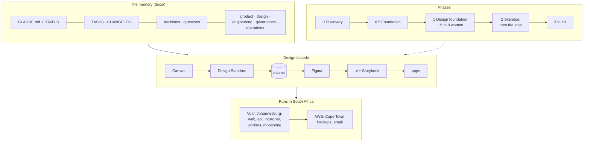
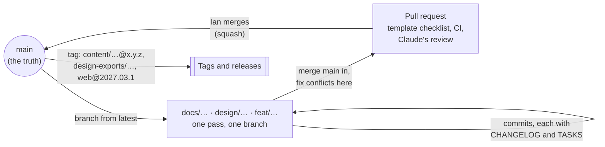
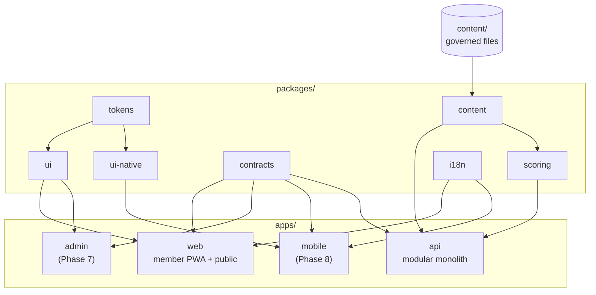
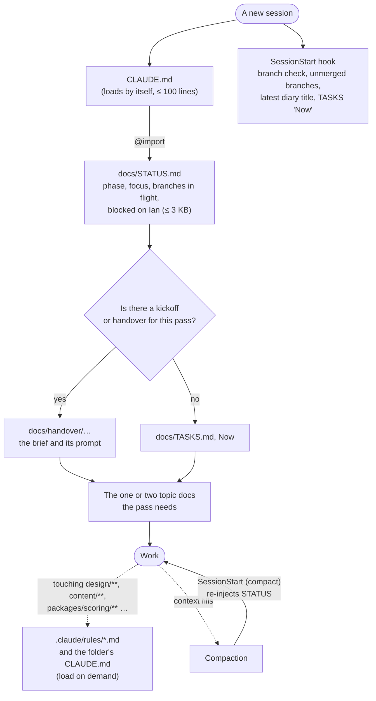
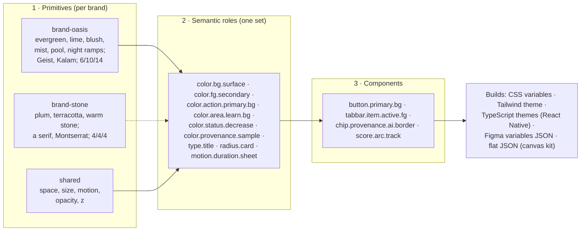
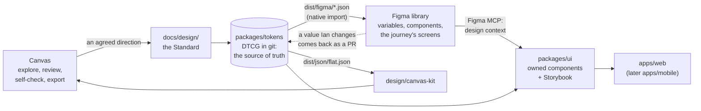

# 17 · The foundation: how we build AWO

> **Status:** Draft v0 for Ian, written in the foundation pass (T-120, 13 October 2026) on the branch `docs/foundation-blueprint`. It researches and proposes; it builds nothing. Nothing here is decided until Ian says so and it lands in the [decision log](../decisions/log.md).
> **The brief:** [handover/2026-10-13-foundation-kickoff.md](../handover/2026-10-13-foundation-kickoff.md).
> **How to read it:** section 1 is the audit (what works and what hurts today, with evidence). Sections 2 to 11 are the blueprint, one area each, and each ends with a recommendation, the alternatives and what Ian decides. Section 12 puts the big forks to Ian; section 13 is the setup plan for the next pass. The appendices hold the proposals (a new CLAUDE.md, templates, settings, skill specs).
> **Quick read (ten minutes):** [At a glance](#at-a-glance), the audit's [what hurts](#13-what-hurts-fix-it-in-the-foundation), then [section 12's decisions](#12-decisions-for-ian). **Its size:** about 110 KB, well over the 40 KB budget section 5 proposes for a topic doc. That's deliberate for a one-off proposal; once Ian decides, each part moves into `docs/product/`, `design/`, `engineering/`, `governance/` or `operations/`, and this file is frozen as the record.

## Contents

- [At a glance](#at-a-glance)
1. [The audit: what works and what hurts](#1-the-audit-what-works-and-what-hurts)
2. [The repository](#2-the-repository)
3. [The folder structure](#3-the-folder-structure)
4. [Our practices](#4-our-practices)
5. [Our docs (the memory)](#5-our-docs-the-memory)
6. [Context and handovers](#6-context-and-handovers)
7. [Our design, from the Round 7 board](#7-our-design-from-the-round-7-board)
8. [Tools](#8-tools)
9. [Assets](#9-assets)
10. [Skills, plugins, subagents, hooks and MCP servers](#10-skills-plugins-subagents-hooks-and-mcp-servers)
11. [The full project](#11-the-full-project)
12. [Decisions for Ian](#12-decisions-for-ian)
13. [The setup plan (the next pass)](#13-the-setup-plan-the-next-pass)

Appendices: [A. A proposed CLAUDE.md](#appendix-a-a-proposed-claudemd) · [B. Templates](#appendix-b-templates) · [C. The folder tree](#appendix-c-the-folder-tree) · [D. Proposed settings](#appendix-d-proposed-changes-to-claudesettingsjson) · [E. Skill specs](#appendix-e-skill-specs) · [F. Facts checked on 13 October 2026](#appendix-f-facts-checked-on-13-october-2026)

**Draft ADRs** (all *Proposed*, in [`docs/decisions/`](../decisions/)): [0001 One monorepo](../decisions/0001-one-monorepo.md) · [0002 Branches, pull requests and merging](../decisions/0002-branches-pull-requests-and-merging.md) · [0003 Binary assets out of git](../decisions/0003-binary-assets-out-of-git.md) · [0004 Design tokens](../decisions/0004-design-tokens.md) · [0005 Governed content as files](../decisions/0005-governed-content-as-files.md) · [0006 Scoring and golden tests](../decisions/0006-scoring-package-and-golden-tests.md) · [0007 The application stack](../decisions/0007-application-stack.md) (Ian's call) · [0008 Hosting and operations](../decisions/0008-hosting-and-operations.md)

## At a glance



The four detailed diagrams: the repo tree (§3.1), the context system (§6.1), design to code (§7.5) and the phases (§11.1). Branches and pull requests are in §2.2, the tokens' layers in §7.4.

## 1. The audit: what works and what hurts

Checked on 13 October 2026 against the repository (49 commits, 24 September to 13 October), its five remote branches, `.claude/settings.json` and the published canvas (`canvas.json`, version 1790881571).

### 1.1 The repository at a glance

| Measure | Today |
|---|---|
| Commits | 49 in 20 days, all by Claude sessions; no pull requests |
| Branches on GitHub | `main` (= `claude/nifty-gauss-7odogg`, the old default), `docs/foundation-kickoff` (two commits ahead of `main`, not merged), `claude/intelligent-hypatia-ja9g5n` (one commit, already inside `docs/foundation-kickoff`), `claude/exciting-cray-7z7fke` (stale at Round 5, already inside `main`) |
| Working tree | `docs/` 331 KB of Markdown; `design/` 21 MB, of which `design/marketing/` is 19 MB (57 PNGs); 53 Python generators (14 552 lines); 7 scripts |
| Git history | 25.5 MB packed; 81 image blobs, 26.5 MB across history |
| Harness | 8 plugins at project scope (D-023), one hook (the changelog), one MCP server (Playwright); no project skills, no subagents, no SessionStart hook |
| Design canvas | 9 pages and 391 boards; the Round 7 board alone has **161 boards in 20 sections** |

### 1.2 What works (keep it)

| What | Evidence |
|---|---|
| **The repo is the memory.** A cold session starts from CLAUDE.md, STATUS and a kickoff prompt, and is working within minutes | This session started from the [kickoff prompt](../handover/2026-10-13-foundation-kickoff.md) with no other context. Three handovers so far, each with a prompt to paste |
| **CLAUDE.md is short** | 77 lines, under doc 06's budget of about 120 |
| **Decisions carry their source** | 44 decisions, each with the owner's words or "Joint", so nobody re-argues a settled point (D-031 even records that it came from a draft typed in a screenshot) |
| **The open-questions register stops invention** | 50 questions. Round 9 raised Q-45 to Q-48 instead of inventing rules for savings-group books, sharing, email and ambassadors, and designed "safe versions" meanwhile |
| **The changelog hook keeps the diary current** | Every commit since the hook arrived (44) touched the CHANGELOG, which holds 47 entries; the five without one came before the hook |
| **Claude self-checks every board** (D-026) | The renders caught real defects: SVG text that doesn't render, a squashed card, overflow under the tab bar, a tooltip over a stone, banding in exports ([10](10-round-4.md), [13](13-round-7.md#round-7-as-the-full-board)) |
| **Generators make the design reproducible** | Every board since Round 5 is regenerated from Python in `design/`. Corners are named constants (`R_S, R_M, R_L = 6, 10, 14`) and are used consistently |
| **Two easings already dominate** | In rounds 7 to 9, `cubic-bezier(.2,.8,.2,1)` (ease-out) appears 163 times and `cubic-bezier(.34,1.56,.64,1)` (the spring) 24 times: motion tokens in all but name |
| **Plugins load everywhere** | D-023: every session of this repo, local or cloud, gets the same eight plugins |
| **The browser works in the cloud** | `scripts/playwright-mcp.sh` and `screenshot.mjs` run the pre-installed Chromium with the proxy pinned, which made research, self-checks and the 18 MB board export possible |

### 1.3 What hurts (fix it in the foundation)

| # | What hurts | Evidence | Where the blueprint answers it |
|---|---|---|---|
| H1 | **Branches drift, and nothing merges them** | GitHub's default was a session branch. Session 3 branched before session 2's commits landed, so both reused IDs; the merge renumbered two docs (09, 10), two questions (Q-31, Q-32) and a task (T-028) ([CHANGELOG, 25 Sep](../CHANGELOG.md)). Today the kickoff itself sat on an unmerged branch, and this session had to bring it in. No branch is protected and no change has gone through a pull request | §2 |
| H2 | **IDs are handed out by whoever writes first** | T-, Q- and D- numbers are taken from the files on the session's branch, so two parallel sessions collide (H1) | §6 |
| H3 | **STATUS isn't a snapshot any more** | 4.7 KB; its "current focus" is one 600-character sentence; "Start here" lists five items, and item 2 still says Ian reacts to Round 8 (T-093), which Round 9 has overtaken | §5 |
| H4 | **TASKS is half history** | 17.8 KB and 92 rows: 62 are Done, 17 wait on Ian (the oldest, T-075 and T-085, since 25 September). The "Now" heading is a paragraph | §5 |
| H5 | **The CHANGELOG grows by about 2.3 KB a day** | 46.6 KB and 313 lines after 20 days. A session reads only the top, but the file costs more each week to open and to edit | §5 |
| H6 | **A cold start costs a lot of context** | The kickoff's reading list is 128 KB (about 32 000 tokens) before any work; all of `docs/` is 331 KB (about 83 000). Round docs are long: doc 14 is 44 KB | §5, §6 |
| H7 | **Binary files live in git** | 57 PNGs (19 MB) in four generations of marketing sets (Rounds 3, 6, 7 and 8), of which only Round 8 is current. Every regenerated PNG adds a new blob for good (81 image blobs, 26.5 MB in history) | §2, §9 |
| H8 | **The photos have one home** | The nappy.co stand-in photos exist only in the canvas's asset store (`/_blob/<id>` in `design/round-5/lib.py`), with no copy in the repository or elsewhere | §9 |
| H9 | **The design isn't a system yet** | The palette is Python constants in `design/round-5/lib.py`, inherited through a chain (round-5 → 6 → 7 → 8 → 9; `sys.path` inserts in 22 files), so archiving Round 5 would break Round 9. Rounds 7 to 9 use **86 distinct raw hex colours**, **36 font sizes** and about **20 gap values** (2, 3, 4, 5, 6, 8, 10, 12, 14, 16, 18, 20, 22, 24, 26, 28, 30, 36, 40): no spacing scale. There is no component inventory, and nothing is in Figma | §7 |
| H10 | **The reference board doesn't say what's current** | The Round 7 board keeps superseded boards beside their replacements: Round 7's Home beside Round 8's, "Store 4: Vault" and a Vault screen although the Vault became Words inside Learn (D-037), and Ask beside Learn's new tabs. Nothing marks which is canonical | §7 |
| H11 | **Two brand systems are open** (Q-49) | The app (evergreen, lime, Geist, corners 6/10/14) and AWO's suggested social brand (plum, terracotta, warm stone, a serif with Montserrat, 4 px corners) differ in every token layer but motion | §7 |
| H12 | **Ian's reactions are the bottleneck** | 17 tasks wait on Ian. Design Standard v1 (T-048) waits on T-075 (Round 7) and Q-49, Q-25, Q-26 and Q-30 | §11, §12 |
| H13 | **The harness has gaps** | No SessionStart hook (T-050), no project skills (T-036), no subagents, no secret scanning, no `permissions` (nothing stops a session reading a future `.env`). The changelog hook only checks that the CHANGELOG changed (not TASKS), and it blocks any command that contains `git commit`, so editing and committing in one call fails | §10 |
| H14 | **The canvas is a single, heavy home** | 161 boards on one page: the canvas's own export gives up, so two scripts were written to download it (an 18 MB PDF). Board layout and notes live only in the artifact's `canvas.json`, not in git | §7, §9 |
| H15 | **No repository basics** | No licence, security policy, pull-request template, `.editorconfig` or Node version file. Fine for Phase 0, needed before code | §2 |
| H16 | **The platform question is open** (Q-10) | Web first or native first decides the first app, the token outputs and the motion runtime | §11, §12 |
| H17 | **The project's plugins don't load in cloud sessions** | D-023 assumed every session, local or cloud, gets the eight plugins. Claude Code's docs (checked 13 Oct 2026) say a cloud session "doesn't install the plugins a repository turns on under `enabledPlugins`". This session bears it out: `context7` and `frontend-design` are absent, and the design and engineering skills present come from Ian's claude.ai account, not the repo. What a cloud session must have has to be committed as `.claude/skills/` and `.claude/agents/`, or enabled on claude.ai ([cloud environments](https://code.claude.com/docs/en/cloud-environments)) | §10 |

### 1.4 What the audit means for the blueprint

- **Most of the memory system is right; it needs budgets, not a rewrite.** The jobs in CLAUDE.md's table are sound. What's missing is a size limit per file, a place for finished things to go (archives), and IDs that can't collide.
- **The branch problem is a process problem.** One branch per pass, a pull request into `main`, and a rule that `main` is the truth would have prevented every collision above.
- **The design language is consistent where it was named** (corners, easings, the area colours) **and drifts where it wasn't** (spacing, greys, type sizes). That is the case for tokens: name the rest.
- **Binaries and the canvas need a home outside git's history**, with the repository keeping only sources and small, final assets.
- **Three things are Ian's before Design Standard v1 can be written:** which brand leads (Q-49), web or native first (Q-10), and the Round 7 reaction (T-075).

## 2. The repository

### 2.1 One repository or several

**One monorepo** (ADR 0001): pnpm 12 workspaces with catalogs, Turborepo 2.11, Node 24 (26 from 28 October), TypeScript 7, Biome. It's what Turborepo recommends (`apps/` and `packages/`), what nearly every strong open-source TypeScript monorepo checked uses (Appendix F.6), and what Expo now supports without hoisting (SDK 54 and later). For AWO it matters most that **one clone gives a cold session the whole picture**: docs, design, content, contracts and code.

### 2.2 `main`, protection and how work reaches it

ADR 0002 has the detail. In short:



- **Protection needs a paid plan.** On GitHub Free, a private repository's branches can't be protected (Appendix F.2). With **GitHub Pro** (about $4 a month, *unverified*), a ruleset on `main` blocks force-pushes and deletion and requires a pull request and green CI, with no required approvals (an author can't approve their own). Without it, a Claude Code hook stops sessions pushing to `main`.
- **Squash merge, one pull request per pass** (or per batch in a long pass). Ian merges.
- **The old session branches** can go once GitHub's default is `main` (T-121): all three are already contained in `main` or in this branch.

### 2.3 Binary assets

ADR 0003: **sources and small masters in git; generated exports out**, published as GitHub release assets (free, up to 2 GiB a file, no total limit). No Git LFS (metered bandwidth, more friction in cloud sessions, and none of the reference repos uses it). The existing PNGs leave the working tree once they're attached to a release; **no history rewrite** (26 MB is small, and docs cite commit hashes).

### 2.4 Repository basics

| File | Proposal |
|---|---|
| `LICENSE` | "Copyright (c) 2026 AWO Holdings (Pty) Ltd. All rights reserved." (the legal name to confirm with Ian; doc 16's source names AWO Holdings (Pty) Ltd) |
| `SECURITY.md` | How to report a problem (an address Ian chooses), what's in scope, and that secrets never go in the repo |
| `.github/pull_request_template.md` | The definition of done for the change's kind (§4.1) as a checklist |
| `.editorconfig`, `.gitattributes`, `.nvmrc` | UTF-8, LF, two spaces; images binary; `docs/CHANGELOG.md merge=union`; Node 24 |
| CODEOWNERS, issue forms | **Skip** until there's a second person (CODEOWNERS isn't enforced on a Free private repo anyway) |

### 2.5 Data location

GitHub stores data in the United States and offers no South African residency (Appendix F.2). The repository holds code, docs, governed content, synthetic fixtures and AWO's own design files: **never member data, member photos or a production database dump.** The data-location register (§4.7) records this as its first row.

**Recommendation:** one monorepo; a pull request per pass, squash-merged by Ian; protect `main` with GitHub Pro; exports as release assets; the four basics above.
**Alternatives:** several repositories; merge commits; staying on Free with the push hook only; Git LFS (ADRs 0001 to 0003 weigh them).
**Ian decides:** GitHub Pro (a paid plan); squash or merge commits; deleting the old branches; the legal name for the licence.

## 3. The folder structure

### 3.1 The whole tree

Folders marked *(Phase 2)* or later aren't created until their phase; the setup pass creates only what Phase 1 uses.

```
awo/
├── CLAUDE.md                 standing orders (≤ 100 lines), imports docs/STATUS.md
├── README.md                 what AWO is, how to start, where the docs are
├── LICENSE                   proprietary: all rights reserved (§2)
├── SECURITY.md               how to report a problem; no secrets in the repo
├── package.json              the workspace root: scripts, packageManager, engines   (Phase 1, with tokens)
├── pnpm-workspace.yaml       workspaces and the version catalog                     (Phase 1)
├── turbo.json                the task graph: build, lint, typecheck, test            (Phase 1)
├── .editorconfig  .nvmrc  .gitattributes  .gitignore
├── .github/
│   ├── workflows/            ci.yml (every pull request), deploy.yml (Phase 2), content.yml
│   ├── pull_request_template.md
│   └── ISSUE_TEMPLATE/       only if Ian moves tasks to Issues (fork F9)
├── .claude/
│   ├── settings.json         plugins, permissions, hooks (§10)
│   ├── skills/               awo-copy-check, awo-design-review, awo-decision, awo-handoff, awo-boards, awo-scoring-change, awo-content-review
│   └── agents/               researcher, accessibility-auditor, copy-checker, design-reviewer
├── docs/
│   ├── README.md  STATUS.md  TASKS.md  CHANGELOG.md  glossary.md  open-questions.md (from Phase 1)
│   ├── decisions/            log.md and the ADRs (NNNN-title.md)
│   ├── handover/             kickoffs and mid-stream transfers
│   ├── product/              PRD, IA, journeys, a spec per feature
│   ├── design/               Design Standard v1 and its parts
│   ├── engineering/          architecture, domain, API, testing, the harness
│   ├── governance/           educational language, AI policy, the data-location register, content review
│   ├── operations/           deploy, backup and restore, incidents, secrets, boards     (runbooks from Phase 2)
│   ├── archive/              finished tasks and old diary months
│   └── 00-discovery/         Phase 0's record, frozen when Phase 1 starts
├── design/
│   ├── README.md             what lives here and what doesn't
│   ├── explorations/         rounds 5 to 9 and brand, moved here unchanged, as a record
│   ├── canvas-kit/           one shared kit for new canvas boards, reading packages/tokens  (Phase 1)
│   └── brand/                master SVGs: wordmark, mark, app icon, the five shapes, the keystone (small, final)
├── content/                  governed content as versioned files (ADR 0005)
│   ├── assessment/  scoring/  evidence/  interpretation/  next-steps/
│   ├── lessons/  words/  facts/
│   └── schemas/              JSON Schemas, one per kind
├── packages/
│   ├── tokens/               DTCG source and its builds: CSS, Tailwind, TypeScript, native   (Phase 1)
│   ├── config/               shared TypeScript, lint and test presets                       (Phase 1)
│   ├── contracts/            schemas and types shared by the API and every client            (Phase 2)
│   ├── scoring/              pure scoring, confidence and interpretation selection, golden tests (Phase 2, ADR 0006)
│   ├── content/              loads and validates content/, builds versioned bundles          (Phase 2)
│   ├── ui/                   the web component library, with Storybook                       (Phase 1 or 2)
│   ├── i18n/                 message catalogues (English first, D-007)                       (Phase 2)
│   └── ui-native/            React Native components                                         (Phase 8, or first if Q-10)
├── apps/
│   ├── web/                  the member PWA and the public pages                             (Phase 2)
│   ├── api/                  the one backend, a modular monolith                             (Phase 2)
│   ├── admin/                AWO Admin, on its own origin                                    (Phase 7)
│   └── mobile/               the Expo app                                                    (Phase 8, or first if Q-10)
├── infra/                    Compose files, Caddy, backups, monitoring, provisioning notes   (Phase 2)
└── scripts/                  boards (render, check, export), hooks, one-off repo scripts
```



### 3.2 Governed content before the admin app

Covered by **ADR 0005**: versioned files with schemas in `content/`, reviewed by pull request, published by tag, loaded by the API with each bundle's hash stored on every result. The database takes over when the admin app arrives (Phase 7).

### 3.3 From the domain map to code

Doc 04's fifteen bounded contexts don't each become a package. Most become **modules inside the API** (`apps/api/src/modules/<context>/`), each with its own routes, service, schema files and tests, talking to other modules only through their exported functions. Only three things leave the API as packages, each for a reason:

| Becomes a package | Why |
|---|---|
| Scoring (with Evidence and Interpretation's selection) | Must be pure, isolated and golden-tested (ADR 0006) |
| Contracts | Shared by every client and the API |
| Content | Its loader and schemas are shared by the API, CI and scripts |

The rest (Identity, Profile, Assessment sessions, Journey, Learning, Community, Buddy, Opportunities, Channels, Reporting, AI, Audit) are API modules. A lint rule (for example `eslint-plugin-boundaries` or dependency-cruiser) stops one module reaching into another's internals, so any module can be pulled out later if it needs to be.

### 3.4 The design generators (`design/round-5` to `round-9`, `design/brand`)

They're a chain: Round 9 imports Round 8, which imports Round 7, which imports Round 6, which imports Round 5's palette (H9). So:

1. **Move them together, unchanged,** to `design/explorations/`. Their imports are relative (`'..', 'round-6'`), so they keep working side by side. They stay runnable as a record, and the published boards stay where they are.
2. **New canvas work** (reviews, quick explorations, the self-check) uses one small kit, `design/canvas-kit/`, that reads colours, type, corners and motion from `packages/tokens`' built JSON. The canvas stays useful, and it can't drift from the real tokens.
3. **Marketing exports leave git** (§2, §9).

**Recommendation:** the tree above; the API as a modular monolith with three packages split out; explorations moved and frozen, with a token-fed kit for new boards.
**Alternatives:** a package per bounded context (fifteen packages for one person is ceremony); everything inside one Next.js app (couples scoring and the API to one client, which doc 04 already rejected); deleting the generators (loses the record and the boards' reproducibility).
**Ian decides:** the tree, and whether `design/explorations/` keeps the old rounds or only the published boards do.

## 4. Our practices

### 4.1 A definition of done

One list per kind of work. A pull request's template carries the list for its kind; Claude ticks it before asking Ian to merge.

| Every change | A doc | A design (board or Figma) | A component | A feature |
|---|---|---|---|---|
| CHANGELOG entry and TASKS updated; STATUS if the focus changed; decision log and open questions if they changed | One job, inside its size budget (§5); linked from `docs/README.md`; UK spelling; no invented rules (each rule cites a D- or a Q-) | Self-checked (D-026): rendered, clicked through, no text under 12 px, no target under 44 px, contrast AA; D1 to D14; reduce motion still works; samples labelled; superseded boards marked | Uses tokens only (no raw values); every state on the component spec (default, pressed, focus, disabled, loading, error; light and night); keyboard and TalkBack names; axe clean in Storybook; a visual snapshot | Its spec in `docs/product/` is agreed; acceptance checks pass as tests; the copy check passes (education only, provenance labels); performance budget met on the mid-range profile (§4.5); a data-location note for anything new it sends or stores; no member data in logs; end-to-end test of the main path |

**The copy check** is the same everywhere: no "you should buy, switch or invest", no credit, approval, eligibility or guarantee language, every number with a sentence (D7), and every governed, AI or sample text with its label (D9). The `awo-copy-check` skill runs it on demand; a script with the same word lists runs in CI on `content/` and message catalogues.

### 4.2 Git and review

- **Commits:** small and focused, a plain-English subject that stands alone (as now). From Phase 2, pull-request titles follow Conventional Commits (`feat(api): …`), since they become the squash commit (ADR 0002).
- **Pull requests:** one per pass or batch; ideally under about 400 changed lines of code (docs and generated files don't count); the template's checklist filled in.
- **Review by Claude:** every code pull request gets a review before merge. Locally, `/code-review` reviews the diff; on GitHub, the `anthropics/claude-code-action` workflow can review on request (it costs Actions minutes and API usage, a paid choice for Ian). Claude Code's managed Code Review is for Team and Enterprise plans only (about $15 to $25 a review, checked 13 October 2026), so it isn't assumed.
- **Review by Ian:** product rules, copy, design and anything touching scoring, content or data. Ian merges.
- **Security review:** `/security-review` on any pull request that touches auth, the API's data access, uploads, AI or infrastructure; the `security-guidance` plugin flags risky edits as they happen (in local sessions).

### 4.3 CI

One workflow (`ci.yml`) on every pull request, with Turborepo's filters so a docs-only change runs only the docs checks.

| Check | Tool (versions checked 13 Oct 2026) | Runs on | Blocks merge |
|---|---|---|---|
| Docs: links, budgets, IDs unique | a small script (Markdown link check, file sizes, duplicate D-, Q-, T- IDs) | every PR | Yes |
| Secrets | gitleaks 8.30 (MIT), or its successor Betterleaks | every PR, and pre-commit | Yes |
| Format and lint | Biome 2.5; ESLint 10 where a plugin needs it | code | Yes |
| Types | TypeScript 7 (`tsgo`) | code | Yes |
| Unit tests | Vitest 5 | code | Yes |
| Golden tests for scoring | Vitest, fixtures in `packages/scoring/golden/` (ADR 0006) | scoring and content | Yes |
| Content | JSON Schema validation and the copy check | `content/`, catalogues | Yes |
| Tokens | the build, plus a contrast check of every semantic pair (§7.4) | `packages/tokens` | Yes |
| Components | Storybook 10's Vitest tests with the accessibility addon (axe) | `packages/ui` | Yes |
| Visual regression | Playwright 1.64 `toHaveScreenshot` on stories and key screens (free, self-run) | UI changes | Yes, once stable |
| End to end | Playwright on the main paths, at 390 px and on the mid-range profile | apps | Yes |
| Accessibility on pages | `@axe-core/playwright` 4.13 on every end-to-end page | apps | Yes |
| Performance | Lighthouse CI 0.15 budgets (§4.5); `size-limit` 14 for JavaScript | web app | Yes, after a baseline |
| Unused code and dependencies | knip 6 | code | Warning |
| Dependencies | Dependabot (no setup) or Renovate (better at grouping pnpm catalog updates) | weekly | No |

**Cost:** GitHub Free includes 2 000 Actions minutes a month on private repositories (Pro: 3 000); Linux minutes cost $0.006 after that. A docs-only pass uses a minute or two; a full code run perhaps ten.

### 4.4 Testing

| Layer | What | Where |
|---|---|---|
| Scoring | Golden tests per method version, property tests for invariants, 100% branch coverage | `packages/scoring` (ADR 0006) |
| Contracts | Schema round-trips; the API's responses validated against the published contract | `packages/contracts`, `apps/api` |
| API | Each module's service with a real Postgres in a container (no mocks of the database); permissions tested as "who can't" as well as "who can" | `apps/api` |
| Components | Every state, axe, keyboard; a visual snapshot | `packages/ui` with Storybook |
| Journeys | The priority journey end to end; offline and slow-network variants | `apps/web` with Playwright |
| Content | Schemas, the copy check, every `sample: true` item renders with its label | `content/` |
| Native (later) | Maestro flows on an Android emulator | `apps/mobile` |
| People | 5 to 8 women each phase that changes the journey (§11) | — |

### 4.5 Accessibility and performance on mid-range Android

**Accessibility.** WCAG 2.2 AA, checked three ways, because tools find only part of the problems (Deque's own study puts axe at 57% of issues by volume):

1. **Automated:** Storybook's accessibility addon on every component state; `@axe-core/playwright` on every end-to-end page, in both modes, **with the WCAG 2.2 rules switched on** (axe's `target-size` rule is off by default); the token contrast check (§7.4).
2. **Manual, per feature** (the `accessibility-auditor` subagent walks it, a person confirms):
   - focus never hidden under the floating tab bar (2.4.11), and a sensible focus order; sheets and dialogs trap and return focus;
   - every drag or swipe has a single-tap alternative (2.5.7): the check-in's pool, sliders, the stones;
   - targets of 44 px (AWO's rule, stricter than 2.5.8's 24 px);
   - sign-in codes can be pasted and filled from the SMS (3.3.8);
   - help is in the same place on every screen (3.2.6); nothing asks twice for what she's already given (3.3.7);
   - reflow at 320 px, and Android's font size at 200%;
   - charts and the DIVA score never rely on colour alone, and each has a sentence;
   - status messages (saved, offline) are announced; provenance labels are read out.
3. **With a screen reader:** TalkBack on Android Chrome first (most members), then VoiceOver on iOS and NVDA on Windows.

**Performance.** The budget is set by cost as much as speed: about **7c a megabyte** in South Africa (ICASA), on Galaxy A-series, Tecno and Infinix phones (Appendix F.5). Proposed budgets, per route on a first visit, under Lighthouse's mobile profile (a slow 4G link and a 4× slower CPU):

| Measure | Budget |
|---|---|
| JavaScript at first load: app routes / public pages | ≤ 150 KB / ≤ 100 KB, compressed |
| Any lazy chunk | ≤ 50 KB |
| CSS | ≤ 25 KB |
| Fonts | ≤ 50 KB (Geist's latin subset, preloaded; Kalam only when a hand moment shows) |
| The largest image | ≤ 60 KB (AVIF) |
| A first visit, all in | ≤ 500 KB (about 3c to 4c) |
| A repeat visit over the network | ≤ 50 KB (the rest from the service worker) |
| Lab: LCP / Total Blocking Time / CLS | ≤ 2.5 s / ≤ 200 ms / ≤ 0.05 |
| Field, at the 75th percentile: LCP / INP / CLS | ≤ 2.5 s / ≤ 200 ms / ≤ 0.1 |

- **No animation runtime in the first load:** CSS and the Web Animations API cover M1 to M4; Rive (about 1 MB) and Lottie load only for wins and Ola, after the page is idle, with a still poster, and never with reduced motion or Save-Data on.
- **Offline:** a service worker (Serwist) precaches the app shell and fonts, tries the network first for pages (three seconds, then the cache), serves saved lessons and words from the cache, and queues a check-in made offline until the signal returns. What it may cache of a member's results is a privacy question for Ian (new Q-52).
- **Real phones:** budgets are checked in CI on the emulated profile and, before each phase ends, on a real Galaxy A06-class phone and a Tecno or Infinix, on a throttled connection.

### 4.6 Versioning

| What | Scheme | Where it's recorded |
|---|---|---|
| Scoring methods, evidence rules, interpretation library, next steps | Semantic versions; published versions immutable | `content/` files and tags (ADR 0005); every result stores the versions and bundle hash |
| The scoring package | Semantic version, recorded on each result | `packages/scoring/package.json` |
| Lessons, Words, facts | A version per item; facts also carry `source` and `checkedOn` (Q-41) | `content/` |
| The API contract | Additive changes only within a major version; `/v1/` in the path | `packages/contracts` |
| Apps | Calendar versions (`2027.03.1`), tagged on release | git tags, the CHANGELOG |
| Tokens and the design standard | Semantic versions; a breaking token rename is a major | `packages/tokens`, `docs/design/` |
| Big decisions | ADRs: Proposed, then Accepted with a D- number | `docs/decisions/` |

### 4.7 The data-location register

A table in `docs/governance/data-location.md` (template in Appendix B): every external service, what it does for AWO, whether member data reaches it, where it stores and processes data, the date checked, and the decision. A pull request that adds a service adds its row, and the CI docs check fails if a new domain appears in `infra/` or an app's configuration without one. §8 seeds it.

### 4.8 Secrets and environments

- **Never in the repository.** `.env*` stays ignored (it already is), with a committed `.env.example` listing names only. `permissions.deny` stops Claude reading `.env` files (§10), and gitleaks runs before every commit and in CI.
- **Environments:** `local` (Docker Compose on a laptop or in a cloud session), `staging` and `production`, both on Vultr in Johannesburg (staging can share the server at first, on its own database).
- **Where secrets live:** production secrets on the server, in files readable only by the service (Docker secrets or `systemd-creds`), backed up encrypted with the server's backups; CI secrets in GitHub Actions secrets (only the deploy key and what CI needs); for Claude sessions, a **network secret** on the cloud environment for any API Claude may call (for example `api.vultr.com`), which Claude Code's proxy attaches without the session ever seeing the value. Network secrets are a Pro and Max plan feature (checked 13 October 2026); on other plans a key would sit in an environment variable that anyone using the environment can read.
- **Rotation:** every secret has an owner and a rotation date in `docs/operations/secrets.md` (names only, never values).

**Recommendation:** the lists above, enforced by the pull-request template and CI rather than by memory.
**Alternatives:** fewer gates at first (faster, but scoring and accessibility bugs are the expensive ones to find late); paid visual testing such as Chromatic (nicer review, but Playwright snapshots are free).
**Ian decides:** whether Claude reviews pull requests on GitHub with the Actions workflow (a running cost), and the performance budget (§4.5).

## 5. Our docs (the memory)

The audit found the jobs right and the sizes wrong (H3 to H6). The proposal keeps every job, gives each file a budget, and gives finished material somewhere to go.

### 5.1 Each doc's job, and what happens to it

| Doc | Its one job | Keep, merge, split or retire | Budget |
|---|---|---|---|
| `CLAUDE.md` (root) | Standing orders: what AWO is, the non-negotiables, how we work, where to look | **Keep**, trimmed: the folder tree moves to `docs/README.md`; STATUS is imported so it loads by itself (§6) | ≤ 100 lines |
| `apps/*/CLAUDE.md`, `packages/*/CLAUDE.md` | Rules for that folder only (scoring's purity, the tokens' layers, the API's privacy rules) | **New**, when the folder exists | ≤ 40 lines each |
| `docs/STATUS.md` | The snapshot: phase, focus, branches in flight, what blocks on Ian | **Keep**, rewritten to a fixed shape (Appendix B) | ≤ 40 lines, ≤ 3 KB |
| `docs/TASKS.md` | The task list: Now, Waiting on Ian, Next, Later, and the last ten done | **Keep**; older done rows move to the archive each month | ≤ 10 KB |
| `docs/CHANGELOG.md` | The diary, newest first | **Keep** the current month; earlier months move to `docs/archive/changelog-YYYY-MM.md` | ≤ 25 KB |
| `docs/decisions/log.md` | Every decision, one line each, with its source | **Keep**; ADRs (`NNNN-*.md`) beside it for big choices | One line per decision |
| `docs/00-discovery/05-open-questions.md` | Everything we must not invent | **Keep** in Phase 0; at the start of Phase 1 it moves to `docs/open-questions.md`, with answered questions as one line each | ≤ 20 KB |
| `docs/glossary.md` | One meaning per word | **Keep** | — |
| `docs/handover/` | A kickoff or a mid-stream transfer, with a prompt to paste | **Keep**, with a template (Appendix B) and a rule for when (§6) | ≤ 250 lines |
| `docs/00-discovery/` | The record of Phase 0 | **Freeze** at the end of Phase 0: a banner says it's history. Its durable content moves into the new folders below, so nobody needs a round doc to build | — |
| `docs/product/`, `design/`, `engineering/`, `governance/`, `operations/` | Durable knowledge, one topic per file | **New**, from the templates in Appendix B | ≤ 40 KB a file; split beyond that |
| `docs/archive/` | Finished tasks and old diary months | **New** | — |

**Where Phase 0's knowledge goes:**

| From | To |
|---|---|
| 01 understanding, 02 product shape | `product/prd.md`, `product/ia.md`, `product/journeys.md` |
| 03 design direction, 07 brand and motion, 11 to 13 (the language, type, corners), 16 (the suggested brand) | `design/standard.md` and its parts (§7.3) |
| 04 technical leanings | `engineering/architecture.md`, `engineering/domain.md` and the ADRs |
| 06 tooling and harness | `engineering/harness.md` (the Claude setup) and `operations/` (rendering and exporting boards) |
| CLAUDE.md's product rules, 02's AI map | `governance/educational-language.md`, `governance/ai-policy.md`, `governance/data-location.md` (the register of services, §4) |
| 14 and 15 (Rounds 8 and 9) | `product/` feature specs, one per area, as each area is specified |

### 5.2 Templates for the new folders

Appendix B has the skeletons. In short:

| Folder | First documents | Template sections |
|---|---|---|
| `product/` | `prd.md`, `ia.md`, `journeys.md`, one `features/<area>.md` per tab | Problem, who it's for, the rules (each with its decision or open question), what's sample, screens on the board, acceptance checks, out of scope |
| `design/` | `standard.md` (an index) with `tokens.md`, `components.md`, `content-style.md`, `motion.md`, `accessibility.md`, `brand.md` | Rule, why, how to check, the board it comes from |
| `engineering/` | `architecture.md`, `domain.md`, `api.md`, `testing.md`, `harness.md`, and ADRs in `docs/decisions/` | Context, decision, consequences; for ADRs, the Proposed, Accepted or Superseded status |
| `governance/` | `educational-language.md`, `ai-policy.md`, `data-location.md`, `content-review.md` | The rule, its source (D- or brief), how it's checked, who approves exceptions |
| `operations/` | `deploy.md`, `backup-restore.md`, `incident.md`, `secrets.md`, `boards.md` | When to use it, steps, the check after each step, how to roll back |

### 5.3 The task tracker once code exists

TASKS.md works because Claude reads and writes it in every commit. **GitHub Issues** (free on a private repository) would add links from commits and pull requests, labels and a board, and sessions can read and write them with the GitHub tools; **Trello** is connected but sits outside the repo, so a cold session wouldn't see it without a tool call. The proposal: **keep TASKS.md as the single list through Phase 1**, then decide at the start of Phase 2. If Ian moves to Issues, TASKS.md shrinks to "Now" and "Waiting on Ian" with links. This is Ian's call (fork F9).

**Recommendation:** keep every job, add the budgets and the archive, freeze `00-discovery/` at the end of Phase 0, and start the five new folders from the templates as Phase 1 needs them.
**Alternatives:** a wiki or Notion for docs (the repo stops being the memory, so no); one big doc per area (too big to load); dropping the CHANGELOG for the git log (loses the "why" and the gotchas).
**Ian decides:** the budgets, the archive, freezing `00-discovery/`, and the tracker (F9).

## 6. Context and handovers

Claude Code's current docs (checked 13 October 2026) change three assumptions in doc 06:

- **CLAUDE.md can import files** with `@path` (up to four hops), and **nested CLAUDE.md files load on demand** when Claude reads or edits a file in that folder ([memory](https://code.claude.com/docs/en/memory)). Imports still cost context; they save a step, not tokens.
- **Path-scoped rules exist:** Markdown files in `.claude/rules/` with a `paths:` list of globs load only when Claude touches a matching file ([memory](https://code.claude.com/docs/en/memory#organize-rules-with-claude/rules/)). Detail can leave the root CLAUDE.md without being lost.
- **After compaction, only the root CLAUDE.md is re-read** (plus recently edited files and invoked skills); what was said only in conversation is gone. A SessionStart hook with the `compact` source can put the snapshot back ([context window](https://code.claude.com/docs/en/context-window#what-survives-compaction)). Auto memory is per machine and isn't shared with cloud sessions, so **the repo stays the memory**.

### 6.1 A cold start in minutes



**The reading budget:** about 15 000 tokens before work starts (CLAUDE.md, STATUS, the handover and one topic doc), against about 32 000 today (H6). Everything else is read when the task needs it.

**What moves out of the root CLAUDE.md into path-scoped rules:**

| Rule file | Loads when Claude touches | Holds |
|---|---|---|
| `.claude/rules/design.md` | `design/**`, `packages/tokens/**`, `packages/ui*/**`, `apps/*/src/components/**` | D1 to D14, M1 to M6, the token layers, "never a raw hex" |
| `.claude/rules/content.md` | `content/**`, `**/*.copy.*`, `packages/i18n/**` | Education only, provenance labels, sample labels, UK spelling, the never-list for email, print and sharing |
| `.claude/rules/scoring.md` | `packages/scoring/**`, `content/scoring/**` | Purity, versioning, golden tests, "AI never" (ADR 0006) |
| `.claude/rules/data.md` | `apps/api/**`, `infra/**` | Data location, the register of services, secrets, privacy by default |

### 6.2 Parallel sessions

- **One branch per pass**, named by type and topic (D-044), made from the latest `main`, merged back by a pull request (§2).
- **STATUS lists the branches in flight**, each with its purpose and the ID ranges it has reserved. A session that starts a parallel branch first commits that line to `main` (a two-line pull request, or a direct commit while `main` isn't protected), so the next session sees it.
- **IDs come from reserved ranges:** a parallel branch takes, for example, T-130 to T-139 and Q-51 to Q-55. That alone would have prevented every renumbering so far (H2).
- **The diary merges itself:** `docs/CHANGELOG.md merge=union` in `.gitattributes` keeps both sides' new entries when two branches add to the top. TASKS and STATUS still need a person (or Claude) to merge, because rows move.
- **Before opening the pull request,** the branch merges the latest `main` into itself and fixes conflicts there, so `main` only ever receives a clean change.
- **Locally,** `claude --worktree <name>` gives each session its own checkout ([worktrees](https://code.claude.com/docs/en/worktrees)); in the cloud, each session already has its own container.
- **`main` is the truth.** A session never builds on another session's unmerged branch unless the brief says so (as this one had to).

### 6.3 When to write a handover, and what goes in it

| Write one | Don't |
|---|---|
| A kickoff: the brief for a new pass, with the prompt to paste (as for Round 8 and this pass) | When the pass is merged and STATUS says what's next |
| Mid-stream: the session nears its context limit or ends with work open on a branch | For a small task the TASKS row already explains |
| Before a long pause on unfinished work | To repeat what the CHANGELOG already says |

**What goes in it** (template in Appendix B, ≤ 250 lines): where we are (three lines); the brief in Ian's words; what's done and what's left, with IDs; taste (what Ian liked and didn't); mistakes not to repeat; gotchas; the next steps in order; and the kickoff prompt. The handover lives on the branch and merges with it.

### 6.4 What to automate, and what stays a habit

| Automate | How | Stays a habit |
|---|---|---|
| The snapshot at the start, and after compaction | `@docs/STATUS.md` in CLAUDE.md; a SessionStart hook (§10) | Keeping STATUS true |
| The changelog check | The existing hook, extended to TASKS, scoped with `if: "Bash(git commit*)"` (§10) | Writing a good entry |
| Installing dependencies in the cloud | A SessionStart hook that runs only when `CLAUDE_CODE_REMOTE` is `true` and `package.json` exists (T-050) | — |
| Ending a session well | The `awo-handoff` skill: updates STATUS and TASKS, writes the handover if work is open, lists unmerged branches, drafts the pull request text | Deciding whether a handover is needed |
| Recording a decision | The `awo-decision` skill: adds the D- line, closes the question, updates STATUS | Ian making the decision |
| Secrets | `permissions.deny` for `.env` files; a secret-scan hook; gitleaks in CI | Never pasting a key into chat |
| Research that eats context | The `researcher` subagent: returns conclusions with dates and sources | Asking for it |
| Comments as inputs | Canvas comments (Artifact comments) and pull-request comments arrive in the session | Ian commenting where the work is |

**Recommendation:** import STATUS from CLAUDE.md, add path-scoped rules, a SessionStart hook and the `awo-handoff` skill; reserve ID ranges for parallel branches; merge the CHANGELOG with the union driver.
**Alternatives:** a bigger CLAUDE.md (every session pays for it); relying on Claude's auto memory (it doesn't reach cloud sessions); one session at a time only (safe, but slower when design and engineering could run side by side).
**Ian decides:** whether parallel sessions are allowed, and the ID-range rule.

## 7. Our design, from the Round 7 board

### 7.1 The Round 7 board, inventoried

The board has **161 boards in 20 sections** (read from the published `canvas.json` on 13 October 2026). Each board is sorted into one of four kinds:

- **Pattern:** something the product reuses, which becomes a token, a component or a screen template.
- **Screen:** one canonical screen of the app, built from patterns.
- **Superseded:** kept as a record, replaced by a later board (the design system ignores it).
- **One-off:** marketing, print, merchandise or an exploration; it follows the system but adds nothing to it.

| # | Section (boards) | Patterns it contributes | Canonical screens | Superseded | One-offs |
|---|---|---|---|---|---|
| 1 | Foundations, brand and structure (7) | Colour per area, type scale, corners, the five shapes, icons, motion M1 to M6, the tab bar with the keystone | — | Round 7's tab bar with the Vault (replaced by the five tabs of D-037) | The Hub icon exploration (dial, awning) |
| 2 | Onboarding (13) | Phone input with country, the code input, consent rows with switches, a PIN pad, the result reveal, choose-one cards | All 13 (welcome photo-led is the front door; three slides is the alternative) | — | — |
| 3 | The 30-day loop (10) | The check-in flow, What changed (with a month that went down), the step picker, a milestone with a share preview, notification list, a lock-screen reminder | All six phone screens | — | Three WhatsApp status cards, the flow board |
| 4 | Home (5) | Bento tiles, goal pools, wins as stories, the hard-moment states (day one, late, coming back, a month down, offline) | Home with several goals (Round 8) plus Round 9's bell; business Home; the goals studio | Round 7's Home (D-031's seven sections live on inside Round 8's) | — |
| 5 | Learn (7) | The Learn switch (Paths, Words, Stories), lesson player (story cards, a quick check, done), the topic stepper, flip and practice cards, Ask with Ola | Learn (Round 8), the lesson player, a topic, Words, Ask | Round 7's Learn; the Vault (now Words, D-037) | — |
| 6 | Stories and companies (6) | The audio player with chapters and a transcript, the story page, the editorial brief | All six, labelled samples | — | — |
| 7 | The Hub, for a job (16) | **The tool skeleton** (her numbers, one plain result, what it means, learn this, make it a goal, share a milestone), sliders, the result card, the AI-reads-a-document flow with consent, All tools | The Hub, All tools and 13 tools | — | — |
| 8 | Business (9) | The business profile and check, the Hub in business mode, an invoice, a shop editor and its public page | All nine | — | — |
| 9 | Community (6) | The feed card (five kinds of post), reactions, the composer with the AI rule check, a thread with reporting | The feed, the composer, a thread, the buddy | Round 7's Community as a whole (its week's question lives on inside the feed) | The feed in parts (a working board) |
| 10 | Me (5) | The DIVA profile (stage, score arc, area bars with last month's marker, evidence meter, versions line), compare, the A4 report, settings rows | All five | — | — |
| 11 | Search and help (3) | One search with filters and a kind "nothing found", help topics, report a problem with amounts hidden | All three | — | — |
| 12 | Other sizes and channels (6) | Desktop and tablet layouts (the phone's cards side by side), the one-question-many-renderers model | Desktop Home and Me, tablet Learn | — | WhatsApp, USSD and the one-question board (later phases, D-009) |
| 13 | Components, widgets and empty states (6) | **Most of the component library:** buttons, tabs, chips (provenance), filters, segmented control, radios, checkboxes, switches, slider, inputs, cards, list rows, stones, story rings, rings and arcs, bars, sparkline, meters, sheets, dialogs, toasts, date picker, file upload, skeletons, two-currency input, ten empty states, widgets | — | — | — |
| 14 | AWO Admin (7) | Inbox-first list, maker-checker diff with checks, the scoring preview, private-by-default tables, a keyboard moderation queue, the audit and AI logs | All seven (Phase 7) | — | — |
| 15 | Around the app (9) | Email templates (welcome, reminder, summary; light and dark), the A5 flyer and slide templates | The three emails | — | The four places mockups |
| 16 to 19 | Marketing (41) | The store-screenshot template (a 2x capture in a frame), square and story ads, the carousel, status cards | — | Round 7's store set and ads (Round 8's are current) | Everything else: the listing, feature graphic, icon, hero, podcast art |
| 20 | Merchandise (5) | — | — | — | All five |

**What this tells us:**

- About **45 patterns** become components, and about **12 screen templates** (onboarding step, tool, lesson, topic, check-in step, result, feed, thread, settings, email, store screenshot, admin list) cover nearly every screen.
- About **20 boards are superseded** (most of them Round 7's marketing set); marking them (a "Superseded by …" note on the board and in its title) is a small change to `design/round-7/group7.py`, proposed in the setup plan.
- The tool skeleton and the DIVA profile are AWO's two signature templates: one is how every Hub tool behaves, the other is where the governed result lives. They deserve the most care in Design Standard v1.

### 7.2 What's already settled, and what isn't

| Settled (decided or consistent across rounds) | Drifts or is open |
|---|---|
| The five areas, each with a colour and a shape (D-028, D-037, D-039): Home evergreen and the pool, Learn night and the moon, the Hub lime and the keystone, Community blush and the ripple, Me pool and the stones | Spacing: about 20 gap values (H9) |
| Geist for all type, Kalam for rare handwritten moments, with the rules in doc 13 (D-032, D-033) | Type sizes: 36 in use; Round 7's type board names only six roles |
| Corners 6, 10 and 14 and a circle; 2 px bar ends | Greys and tints: 86 raw hex values in rounds 7 to 9 |
| Motion M1 to M6; 90, 180, 280 and 600 ms; an ease-out and a spring (wins only) | Elevation: a handful of ad-hoc shadows |
| No red: decreases are grey, destructive actions are wine; lime marks gains | Which brand leads (Q-49), the wordmark (Q-25), Ola (Q-26), theme logic (Q-30), photography (Q-27) |
| One main button per screen: evergreen on light, lime on night | Icon grid and stroke aren't written down (the board's icons are geometric, on 24 px, about 2 px) |

### 7.3 Design Standard v1: the outline

`docs/design/standard.md` is the index; each part is its own file (§5.2). Every rule says why, how to check it and which board shows it.

1. **Principles:** global craft, local truth; D1 to D14; M1 to M6; "plain words first, numbers second".
2. **Brand** *(waits on Q-49, Q-25)*: the wordmark and mark, clear space, the app icon (A, the stepping stones, D-031) at every size, what the brand layer may change and what it may not.
3. **Tokens** (§7.4): colour roles (light and night; the five areas; status without red; provenance), type roles (the Geist scale and Kalam's rules), corners, spacing, size (targets of 44 px), elevation, motion (durations, easings, reduced motion), layout (390 phone, tablet, 1440 desktop; the phone's cards side by side on wide screens), focus, opacity, z-order.
4. **Iconography:** a 24 px grid, a 2 px round-capped line, geometric (the hand belongs to people's words, not icons); the five shapes and the keystone as their own family; sizes 16, 20, 24 and 32.
5. **Components** with every state (about 45 from §7.1): anatomy, variants, states in light and night, behaviour and motion, accessibility (role, name, keyboard, TalkBack), content rules, and what not to do.
6. **Screen templates** (about 12): the onboarding step, the tool skeleton, the lesson, the topic stepper, the check-in step, the result and the DIVA profile, the feed and a thread, settings, search, the email, the store screenshot, the admin list.
7. **Content style:** education only (the copy check), provenance labels, sample labels, numbers with a sentence, locale formats (D6: `R 12 500,00`), UK and South African spelling, first names only in Community, what email, print and sharing never show (Q-46, Q-47).
8. **Data and charts:** decreases in grey, last month's marker, never a credit-meter look (D8), every chart with a sentence and a table for screen readers.
9. **Illustration and Ola** *(waits on Q-26)*: where Ola lives (Learn and Ask only), its states, Rive and its fallbacks.
10. **Photography and people** *(waits on Q-27)*: D4, consent, the grade, never a chip over a face.
11. **Motion:** M1 to M6 with tokens and examples; what each runtime is for (CSS first; Rive and Lottie only for wins and Ola, loaded late); reduced motion.
12. **Accessibility:** WCAG 2.2 AA, the manual checklist (§4.5), TalkBack first.
13. **Channels:** email, print, WhatsApp, USSD and social, each with its limits.

### 7.4 The token architecture

ADR 0004 records the proposal. It follows the **DTCG format's first stable version (2025.10)** and its **resolver** for brands and modes, built with **Terrazzo** (the one tool with full support today; Appendix F.1), in three layers:



**The rules that make it work:**

1. **Semantic tokens point at roles, never at hues.** Each brand file has the same shape: `palette.primary`, `palette.accent`, `palette.highlight`, `palette.neutral` and `palette.night` ramps, `font.family.sans|display|hand`, `radius.sm|md|lg`. Oasis maps evergreen to primary and lime to accent; Stone maps plum to primary and terracotta to accent. Changing brand is switching one resolver input; components, screens and the Figma library don't change.
2. **The five areas are semantic too:** `color.area.home.bg`, `.fg`, `.shape`. In Oasis each area gets its own hue; in Stone (doc 16) the areas collapse to two grounds and one accent, which is just a different mapping. If Q-49 goes either way, nothing above the primitives moves.
3. **Night is a mode, applied to a part of the screen.** On the web, `data-mode="night"` on Learn's and Ask's root redefines every semantic variable inside it (and sets `color-scheme: dark`), so components need no dark variants of their own; in React Native, a scoped theme does the same (Unistyles' `ScopedTheme`, Appendix F.1). Whether the rest of the app follows the phone's dark mode is Q-30; the architecture allows both.
4. **Reduced motion is a mode as well:** `motion: reduced` sets movement durations to zero or swaps them for a short fade (M6), so no component checks the setting by hand.
5. **Contrast is tested, not hoped for.** A CI check computes every foreground and background pair of the semantic layer in every brand and mode, and fails below 4.5:1 for text (3:1 for large text and UI parts). Doc 16's two large-text-only pairs (terracotta on stone, sage on plum) would be caught automatically.
6. **No raw values downstream.** Components use component or semantic tokens only; a lint rule rejects hex colours and pixel values in `packages/ui` and the apps.

**The resolver's axes and their order:** `brand` (oasis | stone, default oasis), `mode` (light | night), `motion` (full | reduced), later `contrast` (default | high). Applied as: shared → brand → semantic → mode → brand overrides → motion → components.

**Names:** dot paths in JSON and TypeScript (`color.bg.surface`), `--awo-` kebab case in CSS (`--awo-color-bg-surface`), following Atlassian's and Primer's patterns (foundation, property, modifier, state).

**What the current values become** (Oasis, light; all from `design/round-5/lib.py` and the Round 7 boards):

| Semantic role | Oasis value | Note |
|---|---|---|
| `color.bg.canvas` / `surface` / `sunken` | mist #EEF3F0 / white / pool #D3E8E4 | |
| `color.fg.default` / `secondary` / `muted` | ink #101814 / #3F4B45 / #56625C | |
| `color.border.subtle` | #DCE4DF | |
| `color.action.primary.bg` / `.fg` | evergreen #0F4A36 / white (night: lime #D8F36A / ink) | One per screen |
| `color.focus.ring` | evergreen (night: mint #86E3C4) | 2 px, offset 3 px |
| `color.status.gain` / `decrease` / `destructive` | lime / a grey / wine #6B2B40 | Never red |
| `color.provenance.reviewed` / `ai` / `sample` | evergreen fill / evergreen dashed / muted dashed | D9 |
| `color.area.{home,learn,hub,community,me}.bg` | evergreen / night #0B0F0E / lime / blush #FFC7D6 / pool | |
| `type.display` / `number` / `title` / `body` / `secondary` / `caption` | Geist 56/600, 44/600 tabular, 28/600, 17/400, 15/400, 13/400 | Floor 12 px; about 8 roles replace 36 sizes |
| `type.hand` | Kalam 400, 20 px or more | One line a screen, doc 13's rules |
| `radius.control` / `.button` / `.card` / `.round` | 6 / 10 / 14 / circle | |
| `space.*` | 2, 4, 6, 8, 12, 16, 20, 24, 32, 40, 56 | A 4 px scale with 2 and 6 for tight spots; 10, 14, 18 and 22 fold in after a visual check |
| `motion.duration.tap` / `toggle` / `sheet` / `win` | 90 / 180 / 280 / 600 ms | |
| `motion.easing.out` / `spring` | `[0.2, 0.8, 0.2, 1]` / `[0.34, 1.56, 0.64, 1]` (wins only) | Both valid DTCG cubic Béziers |

**The package** (`packages/tokens/`): `awo.resolver.json`; `src/primitives/` (shared, `brand-oasis`, `brand-stone`); `src/semantic/` (base, light, night, brand overrides, reduced motion); `src/component/` (one file per component); `terrazzo.config.ts`; and `dist/` with `css/`, `tailwind/theme.css` (Tailwind 4's `@theme inline`, so utilities read the live variables), `ts/` (typed themes for React Native), `figma/` (one file per mode, in the units Figma's import accepts: sRGB, px and seconds) and `json/flat.json` for the canvas kit.

### 7.5 From the canvas to Figma to code



- **The tokens package is the source of truth** (as at GitHub's Primer, which generates its Figma variables from code). Figma imports DTCG JSON natively (Appendix F.4), so the library is fed, not retyped. A value Ian changes in Figma comes back as a reviewed pull request to the tokens.
- **Figma is where Ian designs (D-017) and where the library lives.** Ian's seat today is View (T-020), which can't edit files, use Dev Mode or more than a few MCP calls a month. A **Professional plan with one Full seat** ($16 a month) gives variables with up to 10 modes (Oasis and Stone, light and night is four), Dev Mode and 200 MCP calls a day. Code Connect needs the Organization plan ($55 plus $25 a Dev seat) and isn't worth it for one person. All of this is Ian's call (fork F6).
- **Storybook is the living reference** for components as built: every state, light and night, both brands, with accessibility checks.
- **The canvas stays** for quick explorations, reviews Ian comments on, the self-check, and exports. New boards use the token-fed kit, so they can't drift.

### 7.6 What blocks Design Standard v1

| Blocker | What it blocks | Can work start without it? |
|---|---|---|
| **Q-49** (which brand leads) | The brand layer's values | Yes: the architecture takes either; build Oasis first, Stone as the comparison |
| **T-075** (Ian's reaction to Round 7) | Confirming corners, square buttons and the board as reference | Partly: write the parts he's already settled |
| **Q-25** (the wordmark) | Part 2 and the brand files (§9) | Yes, with the working lockup labelled |
| **Q-26** (Ola) | Part 9 | Yes |
| **Q-30** (theme logic) | Whether the rest of the app gets a night mode | Yes: Learn and Ask are night either way |
| **Q-27** (photography) | Part 10 | Yes, with the stand-ins labelled |
| **Q-10** (web or native first) | Which token outputs and component library come first | Yes: CSS and TypeScript outputs cost little |

**Recommendation:** mark the board's superseded boards; write Design Standard v1 from the outline, starting with tokens and components; build `packages/tokens` with Terrazzo on the DTCG 2025.10 resolver (Oasis first, Stone as a second brand to prove the layer); feed Figma from the tokens.
**Alternatives:** Figma as the source of truth, synced by Tokens Studio (€39 a month for Git sync, and Figma's own modes are limited on cheaper plans); Style Dictionary instead of Terrazzo (wider outputs, but resolver support isn't there yet); no brand layer until Q-49 is answered (cheaper now, a redesign later if the answer is Stone).
**Ian decides:** Q-49; a Figma seat (F6); whether the board's superseded boards get marked; the spacing scale (after a visual check).

## 8. Tools

Every tool with its data-location note, checked on 13 October 2026 (details and sources in Appendix F). "Paid" marks Ian's call. The stack itself is Ian's call too (ADR 0007).

| Area | Tool | Status | Price | Data-location note |
|---|---|---|---|---|
| **Design** | Figma | In use, View seat | Professional Full seat $16 a month (**paid**) | US; no member data, only designs |
| | The canvas (claude.ai) | In use | Included | Anthropic; AWO's designs and stand-in photos only |
| | Rive (Ola, interactive motion) | When Ola is commissioned (Q-26, Q-28) | Free exports carry a splash screen; Cadet $9 a seat a month (**paid**) | Rive's cloud; design files only |
| | Lottie (loops) | When needed | Free with open-source tools | Files in the repo or the asset store |
| | Terrazzo (tokens) | Phase 1 | Free | Runs in CI |
| | Storybook 10 | Phase 1 or 2 | Free | Built in CI; not published publicly |
| **Code** | VS Code or any editor, with Claude Code | In use | — | — |
| | GitHub (repo, pull requests, Actions, releases) | In use, Free plan | Pro about $4 a month to protect `main` (**paid**) | US; code and synthetic data only |
| | Biome, TypeScript 7, Vitest, Playwright, axe, Lighthouse CI, gitleaks, knip, lefthook | Phase 1 and 2 | Free | Run locally and in CI |
| **Runtime** | Next.js, an API (oRPC on Hono or Fastify), Postgres 18, Drizzle, pg-boss, Better Auth, Zod | Phase 2 (ADR 0007, Ian's call) | Free | All self-hosted in Johannesburg |
| | Expo (later) | Phase 8, or first if Q-10 | EAS free tier, Starter $19 a month (**paid** if used) | Builds on Google Cloud, no region stated; no member data in builds |
| **Operations** | Vultr, Docker Compose, Caddy | Account ready (D-043) | Vultr's pricing | Johannesburg |
| | pgBackRest, restic → AWS S3 Cape Town | Phase 2 | About $1 a month (**paid**) | Cape Town (Q-50) |
| | GlitchTip, Gatus, Umami | Phase 2 | Free | Johannesburg |
| **Messages** | Amazon SES, Cape Town | Phase 2, if email is used (Q-17, Q-47) | $0.10 per 1 000 (**paid**) | Cape Town |
| | SMS or WhatsApp for sign-in codes | Phase 2 | Twilio about $0.19 a code; WhatsApp about $0.01 (**paid**) | Outside South Africa with every provider checked: needs a decision (new Q-51) |
| | Web Push (VAPID) | Phase 2 | Free | Encrypted payloads; browser vendors see metadata |
| **AI** (Q-09) | Claude through the Anthropic API, behind AWO's AI gateway | Not before Q-09 | Usage | US (`inference_geo` global or US); no South African option anywhere today |
| **Content** | Content as files in git (ADR 0005); Payload CMS later if non-developers edit; Tolgee self-hosted for translations (Phase 9) | Phase 2 | Free | Johannesburg when self-hosted |
| **Work** | TASKS.md now; GitHub Issues and Projects, or Trello, once code exists (F9) | In use | Free tiers | GitHub US; Trello US |
| **Research** | Unsplash, Mobbin, Fonts connectors | Connected | Mobbin needs a paid plan (**paid**, T-028) | Searches only |

**Recommendation:** the table as it stands: boring, self-hosted in Johannesburg wherever member data is involved, with three small paid services in South Africa (S3 and SES in Cape Town) or for design (Figma).
**Alternatives:** hosted error tracking and analytics (Sentry, PostHog) would be quicker to start but send data abroad; managed Postgres isn't confirmed in Johannesburg.
**Ian decides:** each paid tool (Figma, GitHub Pro, AWS in Cape Town, the sign-in code provider, Rive when Ola is made); the stack (ADR 0007).

## 9. Assets

### 9.1 What exists today

| Asset | Where | Format | Licence | Problem |
|---|---|---|---|---|
| Marketing exports (Rounds 3, 6, 7, 8) | `design/marketing/` | 57 PNGs, 19 MB | AWO's own | Four generations in git; only Round 8's is current (H7) |
| Stand-in photos (nappy.co) | Only in the canvas's asset store (`/_blob/<id>`) | JPEG, PNG | CC0 ([nappy.co licence](https://nappy.co/license)) | One home; no manifest of source and licence per photo (H8) |
| Composite mock-ups (places, devices) | The canvas | HTML boards | Stock or drawn | Say "composite" on the board |
| Icons, the five shapes, the keystone, the stones mark, app icon A | Inline SVG inside the Python generators | SVG strings | AWO's own | No master files |
| Fonts | Google Fonts, loaded by the canvas | Web fonts | Geist and Kalam: SIL OFL 1.1 | Fine; self-host in the app |
| Ola v2 | Canvas boards (CSS and SVG) | — | AWO's own | A sketch; Rive file still to make (Q-26, Q-28) |
| Sample members (Naledi, Wanjiru, Amara, Thandi and others) | Spread across generators and docs | Text | Made up | No single fixture file |

### 9.2 What a build needs, and where each lives

| Asset | Formats and sizes | Lives in | Owner | Licence | Waits on |
|---|---|---|---|---|---|
| **Wordmark and mark** | SVG master; PNG at 1x to 3x for email | `design/brand/` (masters, in git) | Ian (approves), Claude (draws) | AWO's own | Q-25 |
| **App icon** | Android adaptive icon (108 dp foreground and background layers, plus a monochrome layer for themed icons), legacy 48 to 192 px, Play Store 512 px; iOS 1024 px master; PWA 192 and 512 px plus a maskable version; favicons (SVG, 32 px, `apple-touch-icon` 180 px) | Masters in `design/brand/`; generated sizes built in CI into each app | Claude | AWO's own | Q-25 (app icon A is chosen, D-031) |
| **Icon set** | SVG on a 24 px grid, 2 px line; exported as React components | `packages/ui/icons/` (SVG source in git) | Claude | AWO's own, or an open set adapted (Lucide is ISC) | Design Standard part 4 |
| **The five shapes and the keystone** | SVG, plus their animated forms (CSS first) | `design/brand/`, `packages/ui/shapes/` | Claude | AWO's own | — |
| **Ola** | One Rive file with a state machine (idle, listening, thinking, celebrating, resting); still poses as SVG fallbacks | Rive source in the asset store; the `.riv` built into the app | An illustrator or Claude, reviewed by Ian (Q-28) | AWO's own; Rive's paid plan to export without a splash | Q-26, Q-28 |
| **Lottie loops** (onboarding, empty states, wins) | dotLottie, each 50 KB or less | The asset store; loaded late | Claude or a motion designer | AWO's own | — |
| **Fonts** | Geist (variable, latin subset, about 29 KB), Kalam 400 (latin, about 22 KB) | npm packages (`geist`, `@fontsource/kalam`), self-hosted by the app | — | SIL OFL 1.1 | — |
| **Photography** | AVIF and WebP at 1x and 2x, from originals | Originals in a private store in South Africa if they show members; CC0 stand-ins in a GitHub release with a manifest | AWO | Model releases and consent for members (Q-27); CC0 for stand-ins | Q-27 |
| **Templates:** store screenshots and listing, social (carousel, status card), email, PDF report, print (flyer, slides) | Generated from screens and tokens; store PNGs per Google Play's specs | Generators in git; outputs as release assets | Claude | AWO's own | Q-31 (store copy), Q-47 (email and print) |
| **Sample data** | JSON fixtures: sample members, their profiles and money, results by version, Hub tool inputs; the golden profiles for scoring | `packages/fixtures/` or `content/samples/`, in git | Claude | Made up, marked as samples | — |

**A manifest for everything not made by AWO:** `design/assets.md` lists each outside asset (photo, icon set, font) with its source, licence, date and consent, like Bluesky's `ASSETS.md`.

**Recommendation:** SVG masters in git, generated sizes built by CI, binaries as release assets with a manifest, member photography only in South Africa.
**Alternatives:** a digital asset manager (overkill for one person); Figma as the asset store (US, and not versioned with the code).
**Ian decides:** commissioning an illustrator or motion designer for Ola and people (Q-27, Q-28).

## 10. Skills, plugins, subagents, hooks and MCP servers

Checked against Claude Code's docs and the official marketplace on 13 October 2026. The finding that shapes this section is H17: **a cloud session doesn't install the plugins the repo enables.** So anything every session needs must be committed to the repo (`.claude/skills/`, `.claude/agents/`, `.claude/rules/`, hooks in `.claude/settings.json`, servers in `.mcp.json`) or enabled on Ian's claude.ai account, which cloud sessions do load.

### 10.1 Plugins

| Plugin | Today | Proposal | Why |
|---|---|---|---|
| design (knowledge-work) | On | **Keep** (repo, and on claude.ai for cloud) | Critique, accessibility review, UX copy, research synthesis: all used in Phase 1 |
| engineering (knowledge-work) | On | **Keep** | ADRs, testing strategy, deploy checklists |
| figma (knowledge-work) | On | **Keep** | Reading Figma files; writing needs a paid seat (§8) |
| security-guidance | On | **Keep** | Warns on risky edits (local sessions) |
| modern-web-guidance | On | **Keep** until the stack is chosen, then reassess | Web platform practice |
| frontend-design | On | **Keep** | Its "AI tells" list is rule D13's source |
| context7 | On | **Keep**, and add its MCP server to `.mcp.json` so cloud sessions get it too | Current library docs; the repo setting doesn't reach the cloud |
| skill-creator | On | **Keep** | Writing and testing the project skills |
| playwright (official) | Off | **Remove the line**; the project server in `.mcp.json` replaces it | Noise |
| typescript-lsp | — | **Add with the first code** (T-051) | Go-to-definition and diagnostics |
| code-review, pr-review-toolkit | — | **Add with the first code** | Review agents for diffs and pull requests |
| expo | — | **Add with the mobile app** (Phase 8, or first if Q-10) | Expo and React Native know-how |
| hookify, commit-commands, feature-dev | — | **Skip** | Our hooks are few and written by hand; the commit ritual is ours |

### 10.2 Project skills (T-036)

Specs only (Appendix E); none is written until Ian says go. Each lives in `.claude/skills/<name>/SKILL.md`, so it works in cloud sessions.

| Skill | When | What it does |
|---|---|---|
| `awo-copy-check` | Any copy: screens, content, email, store text (model-invoked) | Flags advice, credit, guarantee and eligibility language, missing provenance or sample labels, numbers without a sentence, US spelling |
| `awo-design-review` | A board, a screen or a component before it's published (model-invoked) | Checks D1 to D14, M1 to M6, token use, states, targets and contrast; screenshots as evidence |
| `awo-decision` | Ian decides something (`/awo-decision`) | Adds the D- line with his words, closes the question, updates STATUS, TASKS and any ADR's status |
| `awo-handoff` | End of a session (`/awo-handoff`, never automatic) | Updates STATUS and TASKS, lists unmerged branches, writes a handover if work is open, drafts the pull request |
| `awo-boards` | Rendering, checking or publishing canvas boards (model-invoked) | Doc 06's recipe as steps: fetch, serve, render, `board-check.mjs`, fix, publish, `group7.py` |
| `awo-scoring-change` | Any change under `packages/scoring` or `content/scoring` (model-invoked, `paths`-scoped) | New method version, never edit a published one; update golden files only with a stated reason; run the golden and property tests; record the change |
| `awo-content-review` | A governed content pull request (`/awo-content-review`) | Schema, copy check, versioning, `sample` flags, the reviewer line, and a preview of where it shows |

### 10.3 Subagents (`.claude/agents/`)

| Agent | Tools | Model | Job |
|---|---|---|---|
| `researcher` | Web search and fetch, Read, Write (scratchpad only) | inherit | Wide research; returns conclusions with sources and the date checked, never dumps |
| `accessibility-auditor` | Read, Bash (Playwright, axe), no edits | inherit | Renders a page or board, runs axe, walks the WCAG 2.2 AA list that tools miss (target size, focus not obscured, dragging alternatives, text scaling) |
| `copy-checker` | Read, Grep | a small, fast model | The copy check across many files at once |
| `design-reviewer` | Read, Bash (screenshots), no edits | inherit | `awo-design-review` on many boards in parallel, returning findings with screenshots |

### 10.4 Hooks

| Hook | Event | What it does |
|---|---|---|
| **Snapshot** | `SessionStart` (startup, resume, compact) | Prints the branch (and warns on `main` or `claude/…`), branches ahead of `main` and not merged, the latest CHANGELOG title and TASKS' "Now"; under 1 KB |
| **Install** | `SessionStart` (startup) | Only when `CLAUDE_CODE_REMOTE` is `true` and `package.json` exists: `pnpm install --frozen-lockfile` (T-050) |
| **Changelog** (existing) | `PreToolUse` on Bash, `if: "Bash(git commit*)"` | As now, and also asks for TASKS; the `if` stops it matching `git commit` inside other text |
| **No pushes to `main`** | `PreToolUse` on Bash, `if: "Bash(git push*)"` | Refuses a push to `main` (until GitHub Pro can protect it, ADR 0002) |
| **Secrets** | `PreToolUse` on `Write|Edit` | Refuses content that matches key patterns (the gitleaks rules) |

`permissions.deny` adds `Read(./.env)`, `Read(./.env.*)` and `Read(**/*.pem)`; Claude Code doesn't block them by default.

### 10.5 Connectors and MCP servers

| Server | State on 13 Oct 2026 | Proposal |
|---|---|---|
| Playwright (project, `.mcp.json`) | Works in the cloud | Keep |
| context7 | Only through the plugin, so not in cloud sessions | Add to `.mcp.json` |
| GitHub | The session's built-in GitHub tools work; the engineering plugin's own GitHub server failed to connect (its sign-up was refused) | Use the built-in tools; ignore the plugin's |
| Figma | Connected, View seat | Upgrade when Phase 1 starts (Ian's call, §8) |
| Unsplash | Connected; refuses searches until the account's email is confirmed (T-025) | Confirm the email |
| Mobbin | Needs a paid plan (T-028) | Optional |
| Fonts, tldraw, Trello, HyperFrames | Connected | Keep; Trello only if it becomes the tracker (F9); HyperFrames for motion marketing later |
| The engineering and data plugins' other connectors (Slack, Linear, Notion, Asana, Atlassian, Datadog, Amplitude…) | Need sign-in or fail to connect | Leave idle |

**Recommendation:** commit what the cloud needs (skills, agents, rules, hooks, servers), keep the eight plugins for local sessions, and add the code plugins with the first code.
**Alternatives:** an AWO plugin in its own marketplace (useful only if several repos shared it); relying on claude.ai-enabled skills alone (works in the cloud, but isn't versioned with the repo).
**Ian decides:** go for the skills and agents (T-036), and whether to enable the design and engineering plugins on his claude.ai account for cloud sessions (they appear to be on already).

## 11. The full project

### 11.1 The phases, rechecked

Doc 04's phases still hold. Three changes are proposed: a **foundation step** before Phase 1's design work (this pass and its setup), a **walking skeleton** at the start of Phase 2, and "Explain my result more simply" moved into Phase 2, since it only rewords governed text (doc 04 already suggested it).

```mermaid
flowchart LR
  P0["0 · Discovery<br/>nine rounds, decisions,<br/>open questions"] --> F["0.5 · Foundation<br/>this blueprint, then<br/>the setup pass"]
  F --> P1["1 · Design foundation<br/>Design Standard v1, tokens,<br/>IA, prototype, 5 to 8 women"]
  P1 --> P2a["2a · Walking skeleton<br/>monorepo, CI, deploy to<br/>Johannesburg, backups"]
  P2a --> P2b["2b · The loop, thin<br/>sign in, starter check, result,<br/>one step, check-in, what changed"]
  P2b --> P3["3 · Learning<br/>Paths, Words, Stories"]
  P3 --> P4["4 · Community<br/>feed, moderation, buddy"]
  P4 --> P5["5 · Venture<br/>business check, Hub business mode"]
  P5 --> P6["6 · AI<br/>grounded features, by risk"]
  P6 --> P7["7 · Admin<br/>approvals, versions, audit"]
  P7 --> P8["8 · Native apps<br/>(earlier if Q-10 says native first)"]
  P8 --> P9["9 · Opportunities,<br/>localisation"]
  P9 --> P10["10 · WhatsApp,<br/>then USSD"]
```



The order of 3 to 6 stays open, as doc 04 says. The Hub isn't in doc 04's table because it arrived in Round 8 (D-037); its personal tools fit best beside Learning (Phase 3) and its business tools beside Venture (Phase 5), each tool shipping on its own once its facts have an owner (Q-41).

### 11.2 Phase 1: the design foundation

**What it delivers:**

| Deliverable | What "done" means | Blocked by |
|---|---|---|
| Design Standard v1 (`docs/design/`) | §7.3's outline written, every rule checkable, every component with its states | Q-49, T-075; Q-25, Q-26, Q-30 for their sections |
| `packages/tokens` | The DTCG files and their builds (§7.4), checked for contrast in CI | Q-49 for the brand layer's values; Q-10 for which outputs come first |
| Brand files | The wordmark and app icon in every size (§9) | Q-25 |
| The Figma library | Variables from the tokens; the core components; the priority journey's screens | A paid Figma seat (Ian's call, §8) |
| PRD v1, the feature map and the IA (`docs/product/`) | The five tabs (D-037), each feature with its rules or its open question | Q-12 to Q-15 for the loop's real content |
| The priority journey, as a prototype | Welcome → sign in → starter check → the reveal → the first step → (a month later) the check-in → what changed | The prototype's medium (§12, fork F7) |
| A test with 5 to 8 women | The plan below, run, synthesised and acted on | Recruiting (Ian or AWO) |

**The priority journey** is the core loop, because it's the product's promise: *Where am I? What does it mean? What next? Thirty days later, what changed?*

**How it's tested with 5 to 8 women:**

- **Who:** two or three from each of AWO's first audiences (D-018): employed women in South Africa (like Naledi), women running a business (like Wanjiru, in Kenya or South Africa) and women in the diaspora (like Amara). Mixed ages (25 to 60), mixed confidence with money, and at least three who use a mid-range Android phone daily.
- **How:** one-to-one, 45 minutes, on her own phone where possible (that's the performance test too). In person in Johannesburg or Nairobi where it can be arranged, otherwise a video call with her screen shared. A facilitator and a note-taker; recording only with her consent.
- **Tasks:**
  1. The welcome: "What do you think this app is for? Who is it for?" (five-second test)
  2. Sign in and the starter check.
  3. The reveal: "Tell me in your own words what this says about you." Then: "Is this a credit score?" (it must read as readiness to learn, D-040).
  4. Choose a first step, and say why.
  5. A month later (the facilitator moves the clock): the check-in, then What changed, including the month that went down.
  6. Find what a stokvel payout order means (Words), or open one Hub tool.
  7. Trust: "Who wrote this explanation? What would AWO do with your answers?" (provenance labels, D9).
- **What we measure:** task success and where she got stuck; whether she can explain the DIVA score and the stage correctly; whether anything read as advice, a credit check or a judgement; her words for how it felt (calm, judged, curious, lost); the Single Ease Question after each task; and the time to first step.
- **What we do with it:** a synthesis (the `design:research-synthesis` skill helps), changes to the Design Standard and the prototype, and new open questions where she exposed a rule we don't have.
- **Ethics and data:** sample data only in the prototype, never her real money. Notes keep first names only. Consent, incentives (for example airtime or data vouchers) and where recordings are kept are AWO's call (D-016).

### 11.3 Phase 2's first slice

**2a, the walking skeleton:** the monorepo with CI; `packages/tokens`, `contracts` and `scoring` (with sample rules and golden tests); the API and the member PWA saying hello behind phone sign-in; deployed to Vultr in Johannesburg with Caddy, backups to the second location (Q-50) with one restore drill, uptime checks and error tracking. Nothing a member sees yet, but every pipe is real.

**2b, the loop, thin:** consent; the starter check (sample questions, labelled, until Q-12 and Q-13 are answered); scoring method v0; a result with evidence confidence and pinned interpretation blocks (sample library, Q-14); one next step; the 30-day check-in creating version 2; What changed; the one-page PDF report. **Not in it:** Learn, the Hub, Community, Ask, admin (content is files, ADR 0005), native apps.

**Before real members:** Q-12 to Q-15 answered with AWO's real content, Q-34's approval rule, the email provider (Q-17) if email is used, and the AI posture (Q-09) if "Explain it more simply" ships.

### 11.4 What stays late

The admin app (Phase 7), native apps (Phase 8, unless Q-10 says otherwise), Opportunity Discovery and languages (Phase 9), WhatsApp and USSD (Phase 10), shops and payments (Q-35), live financial data (separate scope), and any paid tier (Q-24).

## 12. Decisions for Ian

The forks, each with Claude's recommendation first. **The big ones** (F1 to F8) shape the setup pass; the smaller ones can take the recommendation as a default unless Ian says otherwise. A one-word answer per fork is enough ("F5: PWA first"); Claude then records each in the decision log, flips its ADR to *Accepted* and closes the matching question.

### The big forks

| # | The fork | Recommended | The alternatives | Cost | Where |
|---|---|---|---|---|---|
| **F1** | One repository or several | **One monorepo**, pnpm and Turborepo | Several repos; Nx instead of Turborepo | Free | ADR 0001, §2.1 |
| **F2** | How work reaches `main`, and protecting it | **A pull request per pass, squash-merged by Ian; GitHub Pro to protect `main`**; delete the old session branches | Merge commits; stay on Free with Claude's push hook only | Pro about $4 a month (*unverified*) | ADR 0002, §2.2 |
| **F3** | Binary files | **Exports out of git as release assets; masters in git; no LFS; no history rewrite** | Git LFS; keep everything in git; rewrite history once | Free | ADR 0003, §2.3 |
| **F4** | The stack | **Doc 04's shape, checked:** Next.js 16; a standalone API with oRPC on Hono or Fastify; Postgres 18 with Drizzle; pg-boss; Better Auth; Zod 4; Tailwind 4 | Fastify REST without oRPC; Kysely or Prisma instead of Drizzle; Expo web for one codebase (not credible for the PWA yet) | Free | ADR 0007 |
| **F5** | Web or native first (Q-10) | **PWA first, native in Phase 8.** The budget is data cost on mid-range Android; a PWA needs no store review, is quickest to put in front of women, and CSS plus a late-loaded Rive cover the motion. Native first would suit Ola and Reanimated better, at the cost of store releases and a heavier download | Native (Expo) first; both at once | — | Q-10, §11 |
| **F6** | Figma, and the source of truth for tokens | **A Figma Professional Full seat for Ian ($16 a month) when Phase 1 starts; tokens in code, fed into Figma.** No Code Connect | Stay on the View seat (Claude can't build the library in Figma); Figma as the source with Tokens Studio (€39 a month) | $16 a month | ADR 0004, §7.5 |
| **F7** | The prototype for 5 to 8 women | **A thin coded PWA** from the real tokens and components, sample data only, no accounts, on the Vultr server: it tests the real performance on her own phone and becomes Phase 2's start | A Figma prototype (needs F6; no real performance); the canvas's linked boards (free and ready, but not an app on her phone) | Free beyond F6 | §11.2 |
| **F8** | Build the brand layer before Q-49 is answered | **Yes:** semantic tokens point at roles, not hues, with Oasis first and Stone as a second brand to prove it. And Q-49 itself: Claude still leans to one identity, with the social system borrowing the app's colours and Geist | No brand layer until Q-49 is answered (a redesign later if Stone leads) | Free | ADR 0004, §7.4, Q-49 |

### The smaller calls (defaults unless Ian says otherwise)

| # | The call | Default | Where |
|---|---|---|---|
| F9 | The task tracker once code exists | TASKS.md through Phase 1; decide on GitHub Issues (free) or Trello at the start of Phase 2 | §5.3 |
| F10 | Governed content before the admin app | Versioned files in git with schemas (ADR 0005); who reviews it is Q-07 and Q-34 | ADR 0005 |
| F11 | Scoring's shape | A pure package with golden and property tests (ADR 0006) | ADR 0006 |
| F12 | Backups and email | AWS in Cape Town: S3 for the second backup copy (answers Q-50) and SES for email (part of Q-17); about $1 to $2 a month | ADR 0008 |
| F13 | Sign-in codes (Q-51) | AWO's own sender; WhatsApp where she has it, SMS as the fallback; the provider chosen with its data-location note | ADR 0007 |
| F14 | Docs | Budgets, an archive, freezing `00-discovery/` when Phase 1 starts, the templates | §5 |
| F15 | Parallel sessions | Allowed, with reserved ID ranges in STATUS and the CHANGELOG's union merge | §6.2 |
| F16 | The harness | Go for Appendix A's CLAUDE.md, the path-scoped rules, the four hooks, the `context7` server, seven skills and four subagents | §6, §10 |
| F17 | Claude reviewing pull requests on GitHub | Not yet: `/code-review` in the session is free; the Actions workflow costs minutes and API usage | §4.2 |
| F18 | The Round 7 board | Mark its superseded boards; move the old generators to `design/explorations/` | §3.4, §7.1 |
| F19 | The licence | Proprietary, "All rights reserved", in the name of AWO Holdings (Pty) Ltd (the legal name to confirm) | §2.4 |

**Still waiting on Ian from before this pass,** and blocking Design Standard v1: T-075 (Round 7), Q-49, Q-25, Q-26, Q-30 and Q-27 (§7.6).

## 13. The setup plan (the next pass)

Small steps, in order, each with the check that says it's done. **Part A** changes docs, the harness and the repo's housekeeping, and starts once Ian approves the blueprint. **Part B** is the first code in the repository (the workspace and the tokens package) and starts only when Ian says code may begin. Each step is its own commit; each part is one pull request.

### Part A: housekeeping, docs and the harness (no product code)

| # | Step | Check |
|---|---|---|
| A1 | Ian switches GitHub's default branch to `main` (T-121) and merges this pass's pull request | `main` holds doc 17 and the ADRs; GitHub shows `main` as default |
| A2 | Record Ian's answers to §12: D-045 onwards, ADRs to *Accepted* or rewritten, questions closed | No ADR Ian decided still says *Proposed*; the questions' rows say "Answered → D-…" |
| A3 | Repo basics: `LICENSE`, `SECURITY.md`, `.editorconfig`, `.gitattributes` (LF, images binary, `docs/CHANGELOG.md merge=union`), `.nvmrc`, the pull-request template | `git check-attr merge docs/CHANGELOG.md` says `union`; the next pull request opens with the template |
| A4 | If F2 is yes: GitHub Pro and a ruleset on `main` (no force-push or deletion, pull request and CI required) | A test push to `main` from a scratch clone is refused |
| A5 | If Ian agrees: delete `claude/nifty-gauss-7odogg`, `claude/intelligent-hypatia-ja9g5n`, `claude/exciting-cray-7z7fke` and the merged `docs/` branches | `git ls-remote --heads` lists `main` and open work only |
| A6 | The docs to budget: STATUS in its fixed shape; TASKS' older done rows to `docs/archive/tasks-2026.md`; CHANGELOG months before October to `docs/archive/changelog-2026-09.md`; `docs/README.md` with each doc's job and budget | A size script reports every file within budget; the link check passes |
| A7 | CLAUDE.md as Appendix A (with Ian's edits), `.claude/rules/` (design, content, scoring, data) | Root CLAUDE.md ≤ 100 lines; in a fresh cloud session `/context` shows CLAUDE.md and STATUS; touching `design/` loads the design rule |
| A8 | Hooks and permissions (Appendix D): the session-start snapshot, the changelog hook with `if` (and TASKS), no push to `main`, no secrets; `permissions.deny` for `.env` and keys | Scripted cases: a commit without a CHANGELOG entry is blocked; `git push origin main` is refused; writing a fake key is refused; reading `.env` is denied; the snapshot is under 1 KB and appears after `/compact` |
| A9 | `context7` in `.mcp.json` (any key as a network secret) | A cloud session lists the context7 tools |
| A10 | Skills and subagents (Appendix E, §10.3), written and tested with `skill-creator` | Each skill run once on a real case (the copy check on Round 9's emails, the design review on one board, a decision and a handoff on a test branch), results noted in the CHANGELOG |
| A11 | Binary assets: releases `design-exports/round-3` to `round-8` and `assets/stand-in-photos` (the nappy.co photos fetched from the canvas), `design/assets.md` as the manifest; the PNGs leave the tree; `.gitignore` for exports | Each release downloads and opens; every photo is in the manifest with source and licence; the working tree shrinks by about 19 MB |
| A12 | Move `design/round-5` to `round-9` and `design/brand` into `design/explorations/`; update doc 06, the generators' READMEs and CLAUDE.md's paths | `python3 design/explorations/round-9/round9.py --help` (or a dry run) still imports its chain; `group7.py` runs |
| A13 | Mark superseded boards on the Round 7 board (`group7.py`), and republish | The board renders; about 20 titles say "Superseded by …"; `board-check.mjs` passes |
| A14 | CI for docs (`.github/workflows/ci.yml`): links, budgets, unique D-, Q- and T- IDs, gitleaks | Green on the setup pull request; a deliberately broken link fails it |
| A15 | The data-location register, `docs/governance/data-location.md`, seeded from §8 and ADR 0008 | Every service named in §8 has a row with its date checked |
| A16 | The first Phase 1 docs from the templates: `docs/design/standard.md` (the outline of §7.3) and `docs/product/prd.md` (headings, rules linked to D- and Q- IDs) | Both within budget and linked from `docs/README.md` |

### Part B: the first code (only after Ian's go)

| # | Step | Check |
|---|---|---|
| B1 | The workspace: root `package.json` (pnpm 12 pinned, Node 24, then 26), `pnpm-workspace.yaml` with a catalog, `turbo.json`, `packages/config` (TypeScript and Biome presets), lefthook, and the SessionStart install hook | In a fresh cloud session the hook installs and `pnpm check` passes on the empty workspace |
| B2 | `packages/tokens`: DTCG 2025.10 sources for Oasis (light and night) and Stone, the resolver, a Terrazzo build to CSS, Tailwind, TypeScript, Figma JSON and flat JSON; the contrast test | The build passes; the contrast test passes for Oasis and reports Stone's two large-text-only pairs at the values doc 16 measured (3.86:1 and 4.44:1) |
| B3 | `design/canvas-kit` reading the flat JSON; the Type and corners board regenerated from it | `board-check.mjs` passes; a screenshot diff with the published board shows only intended changes |
| B4 | CI's code jobs with Turborepo filters | A docs-only pull request skips them; a token change runs them |
| B5 | If F6 is yes: the Figma library file gets the tokens through Figma's native import | Figma shows the variables with four modes (two brands, light and night) matching the CSS values |

**Then Phase 1 proper:** Design Standard v1 written part by part (tokens and components first), components in `packages/ui` with Storybook, the prototype for the women (F7), and the test (§11.2).

## Appendix A. A proposed CLAUDE.md

A proposal, not a change: the live CLAUDE.md stays as it is until Ian approves. It keeps every non-negotiable, moves the folder tree to `docs/README.md`, moves detail into path-scoped rules (§6.1) and imports the snapshot.

````markdown
# AWO: standing orders for Claude

AWO (African Wealth Oasis) is a financial **education, intelligence and community** platform for African women in Southern Africa and the diaspora. Its loop: *Where am I? (DIVA profile) → What does it mean? (governed interpretation) → What next? (one step) → 30-day check-in → progress.*

@docs/STATUS.md

## Start here
1. STATUS (above) says the phase, the focus, the branches in flight and what waits on Ian.
2. If STATUS names a kickoff or handover, read it next. Then TASKS, "Now".
3. Before proposing anything, check the decision log and the open questions. Use the glossary's words.
4. Read other docs only when the task needs them; `docs/README.md` is the map.

**Owner and builder:** Ian Kuria (D-015). Designs in Figma. **Product code:** only when STATUS says the phase allows it.

## Non-negotiables: product
- Educational scope only: no personalised advice, credit decisions, execution, pooling or investor matching. Copy says learn, understand, explore.
- DIVA scoring and interpretation are server-side, deterministic, versioned and auditable; results are immutable. Evidence confidence is separate from the score. Categories describe educational readiness only.
- AI never computes scores, picks categories, writes outside the governed library or recommends products or providers. AI output is labelled and logged.
- Never invent business rules: label samples, log the gap as an open question.
- Member data stays in South Africa; every external service gets a line in the data-location register. Compliance analysis is AWO's (D-016).

## Non-negotiables: design
- Global craft, local truth: Africa in substance, never decoration. D1 to D14 and M1 to M6 apply (loaded with design files).
- Mobile-first for mid-range Android on patchy data; WCAG 2.2 AA; targets of 44 px or more; respect reduce motion.
- Ola lives only in Learn and Ask. Provenance is visible: Reviewed by AWO, AI-assisted, Sample.

## How we work
- Docs are the memory; each has one job and a size budget (`docs/README.md`). Don't create ad-hoc files.
- One branch per pass, named by type and topic (D-044), from the latest `main`, merged by pull request. Parallel branches reserve ID ranges in STATUS.
- Every commit: a CHANGELOG entry and TASKS (a hook checks). STATUS when the focus changes; the decision log and open questions when they change.
- Ask when it's Ian's call (product rules, brand, compliance, priorities, paid tools). Decide implementation details, explain them and record the important ones.
- End of session: run `/awo-handoff`.
- UK and South African spelling. Small, focused commits. Never commit secrets or real member data.
````

## Appendix B. Templates

Each template is a skeleton for the setup pass to copy into place. Headings only, with one line on what goes in each.

**STATUS.md (fixed shape, ≤ 40 lines)**

```markdown
# Status
**Phase:** … · **Last updated:** YYYY-MM-DD, by … (session or pass)
**Focus:** one or two sentences.

## Branches in flight
| Branch | Purpose | Reserved IDs | Opened |

## Start here
1. … (at most three links)

## Waiting on Ian
T-… · T-… (IDs only; details in TASKS)

## Pointers
Canvas · hosting · environment notes (one line each)
```

**A feature spec (`docs/product/features/<area>.md`)**

```markdown
# <Feature>
> Status: Draft | Agreed (D-…) · Board(s): R7-… · Phase: …
## The problem, in her words
## Who it's for (sample members)
## What it does (the flow, step by step)
## The rules (each with its D- or Q-)
## What is sample until AWO decides
## Data it touches, and where it lives
## Acceptance checks (testable)
## Out of scope
```

**A component spec (`docs/design/components/<name>.md`)**

```markdown
# <Component>
Board: … · Tokens: … · Status: Draft | Stable
## Anatomy  ## Variants  ## States (default, pressed, focus, disabled, loading, error; light and night)
## Behaviour and motion (which M-rule)  ## Accessibility (role, name, keyboard, TalkBack, target size)
## Content rules  ## Don't
```

**An ADR (`docs/decisions/NNNN-title.md`)**

```markdown
# ADR NNNN: <title>
- Status: Proposed | Accepted (D-…) | Superseded by NNNN
- Relates to: D-…, Q-…
## Context  ## Options (a table: for, against)  ## Decision  ## Consequences
## Data-location note  ## Ian decides (while Proposed)
```

**A governance policy (`docs/governance/<policy>.md`)**

```markdown
# <Policy>
Source: brief | D-… · Owner: … · Reviewed: YYYY-MM-DD
## The rule  ## Why  ## How it's checked (automated, by review)  ## Examples (allowed, not allowed)  ## Exceptions and who approves them
```

**A runbook (`docs/operations/<task>.md`)**

```markdown
# <Task>
When to use it · How long it takes · Who can run it
## Before you start (access, backups)  ## Steps (each with its check)  ## Roll back  ## After (what to record)
```

**The data-location register (`docs/governance/data-location.md`)**

```markdown
| Service | What it does for AWO | Member data? | Where it stores and processes | Checked on | Decision |
```

**A handover (`docs/handover/YYYY-MM-DD-<topic>.md`, ≤ 250 lines)**

```markdown
# Handover: <topic> (date)
## Where we are (three lines)
## The brief (Ian's words, tidied)
## Done and left (with IDs)
## Taste: what Ian liked and didn't
## Mistakes not to repeat
## Gotchas
## Next steps, in order
## The kickoff prompt (to paste)
```

**A package's CLAUDE.md (≤ 40 lines)**

```markdown
# <package>: rules for Claude
What it is (one line) · Who uses it · How to test it (`pnpm --filter <name> test`)
## Must
## Must not
## Gotchas
```

## Appendix C. The folder tree

The whole tree is in §3.1. The setup pass creates only: `LICENSE`, `SECURITY.md`, `.editorconfig`, `.gitattributes`, `.nvmrc`, `.github/pull_request_template.md`, `.github/workflows/ci.yml` (docs checks first), `.claude/skills/`, `.claude/agents/`, `.claude/rules/`, `docs/archive/`, `docs/product/`, `docs/design/`, `docs/engineering/`, `docs/governance/`, `docs/operations/` (each with its first document from Appendix B), and moves `design/round-*` and `design/brand` into `design/explorations/`. `apps/`, `packages/`, `content/` and `infra/` wait for Ian's go on code.

## Appendix D. Proposed changes to `.claude/settings.json`

A proposal; the file isn't changed in this pass.

```json
{
  "extraKnownMarketplaces": { "...": "unchanged" },
  "enabledPlugins": {
    "design@knowledge-work-plugins": true,
    "figma@knowledge-work-plugins": true,
    "engineering@knowledge-work-plugins": true,
    "security-guidance@knowledge-work-plugins": true,
    "modern-web-guidance@knowledge-work-plugins": true,
    "frontend-design@claude-plugins-official": true,
    "context7@claude-plugins-official": true,
    "skill-creator@claude-plugins-official": true
  },
  "enabledMcpjsonServers": ["playwright", "context7"],
  "permissions": {
    "deny": ["Read(./.env)", "Read(./.env.*)", "Read(**/*.pem)", "Read(**/*.key)"]
  },
  "hooks": {
    "SessionStart": [
      { "matcher": "startup|resume|compact",
        "hooks": [{ "type": "command", "command": "bash \"$CLAUDE_PROJECT_DIR/scripts/hooks/session-start.sh\"", "timeout": 600 }] }
    ],
    "PreToolUse": [
      { "matcher": "Bash",
        "hooks": [
          { "type": "command", "if": "Bash(git commit*)", "command": "bash \"$CLAUDE_PROJECT_DIR/scripts/hooks/require-changelog.sh\"", "timeout": 15 },
          { "type": "command", "if": "Bash(git push*)", "command": "bash \"$CLAUDE_PROJECT_DIR/scripts/hooks/no-push-to-main.sh\"", "timeout": 15 }
        ] },
      { "matcher": "Write|Edit",
        "hooks": [{ "type": "command", "command": "bash \"$CLAUDE_PROJECT_DIR/scripts/hooks/no-secrets.sh\"", "timeout": 15 }] }
    ]
  }
}
```

And in `.mcp.json`, beside Playwright, the context7 server (its URL and any key as the context7 docs say on the day; a key would be a network secret, never committed). `session-start.sh` does the snapshot always, and the install only when `CLAUDE_CODE_REMOTE` is `true` and `package.json` exists.

## Appendix E. Skill specs

Each spec says when the skill runs, its steps and its checks. The setup pass writes them with `skill-creator` and tests each on a real case.

**`awo-copy-check`** · model-invoked · `allowed-tools: Read, Grep`
- *When:* any new or changed copy: a screen, a content file, an email, store text, a notification.
- *Steps:* collect the strings; check each against the word lists (advice: "you should", "invest in", "buy", "switch to"; credit: "approved", "eligible", "credit score", "qualify"; guarantees: "guaranteed", "will grow", "risk-free"); check provenance and sample labels where governed, AI or sample text appears; check every number has a sentence (D7); check UK spelling.
- *Checks:* returns a table (string, file, problem, a suggested rewrite in AWO's voice). Never rewrites governed text itself.

**`awo-design-review`** · model-invoked
- *When:* before publishing a board, or when a component or screen changes.
- *Steps:* render it (via `awo-boards` or Playwright); check D1 to D14 and M1 to M6; check tokens (no raw hex, sizes on the scale); states; 44 px targets; contrast; reduce motion; Ola only in Learn and Ask; no handwriting on numbers, results or AI text.
- *Checks:* findings ranked (breaks a rule, weakens the design, a nit) with screenshots.

**`awo-decision`** · `/awo-decision` only (`disable-model-invocation: true`)
- *When:* Ian decides something.
- *Steps:* add the D- line (date, decision, source with his words, notes); mark the open question answered; set an ADR to Accepted if one exists; update STATUS and TASKS; add the CHANGELOG entry.
- *Checks:* the D- number is the next free one on `main` (fetched first); no other doc still calls it open.

**`awo-handoff`** · `/awo-handoff` only
- *When:* the end of a session.
- *Steps:* `git status` and `git log` (injected); update STATUS (fixed shape) and TASKS; list unmerged branches; if work is open, write a handover from the template with a kickoff prompt; draft the pull request's description; commit and push.
- *Checks:* STATUS within budget; every ID mentioned exists; the branch is pushed.

**`awo-boards`** · model-invoked
- *When:* rendering, checking or publishing canvas boards.
- *Steps:* doc 06's recipe: fetch the page and assets into the scratchpad; serve; render each board; run `board-check.mjs`; fix breakage only (D-026); publish; regroup with `group7.py`; mark superseded boards.
- *Checks:* no text under 12 px, no target under 44 px, no unresolved bindings, no overflow; screenshots kept in the scratchpad, never committed.

**`awo-scoring-change`** · model-invoked, `paths: packages/scoring/**, content/scoring/**`
- *When:* any change to scoring code or a method.
- *Steps:* never edit a published method: copy to a new version; run golden and property tests; if a golden file must change, write why in the pull request; record the method and package versions.
- *Checks:* the tests pass; no published file changed; the CHANGELOG names the versions.

**`awo-content-review`** · `/awo-content-review`
- *When:* a governed content pull request.
- *Steps:* validate schemas; run the copy check; check versions, `status`, `sample` flags and `reviewedBy`; show where each item appears.
- *Checks:* a summary Ian can approve from.

## Appendix F. Facts checked on 13 October 2026

Research for this pass, checked on the day: versions from the npm registry (`registry.npmjs.org/<name>/latest`), everything else from the vendor's own docs, pricing pages or release notes. Prices are in US dollars unless stated, and change: recheck before paying for anything. Items a source couldn't confirm are marked *unverified*.

### F.1 Versions and licences

| Package | Latest | Licence | Note |
|---|---|---|---|
| Node.js | 24 LTS; 26 becomes LTS on 28 Oct 2026 | MIT | Corepack no longer ships from Node 25 ([schedule](https://github.com/nodejs/Release)) |
| pnpm | 12.11.2 | MIT | Catalogs since 9.5 |
| turbo | 2.11.8 | MIT | |
| typescript | 7.0.2 | Apache-2.0 | Native compiler, stable since 8 Jul 2026; no programmatic API yet, so some tools alias TypeScript 6 ([Microsoft](https://devblogs.microsoft.com/typescript/)) |
| @biomejs/biome | 2.5.15 | MIT or Apache-2.0 | |
| eslint | 10.12.0 | MIT | Flat config only; v9 reached end of life on 6 Aug 2026 |
| next | 16.4.0 | MIT | [Self-hosting guide](https://nextjs.org/docs/app/guides/self-hosting) |
| react | 19.3.0 | MIT | |
| expo | 57.0.28 (SDK 57) | MIT | React Native 0.86; the New Architecture only; pnpm isolated installs supported since SDK 54 ([monorepos](https://docs.expo.dev/guides/monorepos/)) |
| hono / fastify | 4.13.13 / 5.12.7 | MIT | Hono 5 in release candidate; Fastify 6 in alpha |
| zod | 4.6.7 | MIT | |
| drizzle-orm | 0.45.4 | Apache-2.0 | 1.0 in release candidates since Apr 2026 |
| pg-boss | 12.38.0 | MIT | Needs Postgres 13+ |
| better-auth | 1.7.7 | MIT | Joined Vercel, Jul 2026; about 40 advisories to date, one critical in Sep 2026 ([advisories](https://github.com/better-auth/better-auth/security/advisories)) |
| tailwindcss | 4.3.3 | MIT | |
| vitest / @playwright/test / storybook | 5.0.4 / 1.64.0 / 10.6.2 | MIT / Apache-2.0 / MIT | |
| @axe-core/playwright / @lhci/cli / size-limit | 4.13.0 / 0.15.1 / 14.2.0 | MPL-2.0 / Apache-2.0 / MIT | axe's WCAG 2.2 `target-size` rule is off by default |
| @terrazzo/cli / style-dictionary | 2.8.0 / 5.6.1 | MIT / Apache-2.0 | Terrazzo supports the DTCG 2025.10 resolver; Style Dictionary's support is "a work in progress" ([SD](https://styledictionary.com/info/dtcg/)) |
| serwist | 9.5.13 | MIT | |
| geist / @fontsource/kalam | 1.7.2 / 5.3.0 | SIL OFL 1.1 | Geist's latin subset about 29 KB; Kalam is static only, about 22 KB per weight (latin) |
| @rive-app/react-canvas / motion | 4.36.0 / 14.2.0 | MIT | Rive's canvas runtime is about 0.97 MB gzipped (lite 0.42 MB) |
| nativewind / react-native-unistyles | 4.2.7 / 3.5.3 | MIT | NativeWind 5 (Tailwind 4) is a release candidate |
| lefthook / knip / gitleaks | 2.2.2 / 6.41.0 / 8.30.1 | MIT / ISC / MIT | gitleaks is "feature complete"; its author now works on Betterleaks |
| PostgreSQL | 18.6 | PostgreSQL | |
| pgBackRest / restic | 2.59.3 / 0.19.1 | MIT / BSD-2 | |
| Caddy | 2.11.7 | Apache-2.0 | |
| GlitchTip / Umami | 6.2.6 / 3.4.0 | MIT | Umami runs on Postgres alone |

**Avoid:** MinIO (repository archived 25 Apr 2026), Lost Pixel (joining Figma, product ending), Lucia (deprecated Mar 2025), Highlight (hosted service ended Feb 2026).

### F.2 GitHub

| Fact | Source |
|---|---|
| Protected branches and rulesets on **private** repositories need Pro, Team or Enterprise | [Protected branches](https://docs.github.com/en/repositories/configuring-branches-and-merges-in-your-repository/managing-protected-branches/about-protected-branches) |
| An author can't approve their own pull request | [Required reviews](https://docs.github.com/en/pull-requests/collaborating-with-pull-requests/reviewing-changes-in-pull-requests/approving-a-pull-request-with-required-reviews) |
| No secret scanning for personal private repositories short of Enterprise; user push protection covers public repositories only | [Secret scanning](https://docs.github.com/en/code-security/secret-scanning/introduction/about-secret-scanning) |
| Actions: 2 000 minutes a month on Free, 3 000 on Pro; Linux $0.006 a minute after | [Actions billing](https://docs.github.com/en/billing/concepts/product-billing/github-actions) |
| LFS: 10 GiB storage and 10 GiB bandwidth on Free and Pro; release assets up to 2 GiB each, no total or bandwidth limit | [LFS billing](https://docs.github.com/en/billing/concepts/product-billing/git-lfs), [releases](https://docs.github.com/en/repositories/releasing-projects-on-github/about-releases) |
| Data residency only on Enterprise Cloud (EU, Australia, Japan); no South Africa | [Data residency](https://docs.github.com/en/enterprise-cloud@latest/admin/data-residency/about-github-enterprise-cloud-with-data-residency) |
| Pro's price isn't on GitHub's pricing page; about $4 a month per a third-party source (*unverified*) | [Pricing](https://github.com/pricing) |

### F.3 Claude Code

| Fact | Source |
|---|---|
| `@path` imports in CLAUDE.md (up to four hops); nested CLAUDE.md files load on demand; `.claude/rules/*.md` with `paths:` globs | [Memory](https://code.claude.com/docs/en/memory) |
| After compaction the root CLAUDE.md is re-read; a SessionStart hook with the `compact` source can re-inject context | [Context window](https://code.claude.com/docs/en/context-window) |
| Skills in `.claude/skills/<name>/SKILL.md`, with `disable-model-invocation`, `allowed-tools`, `paths`, `context: fork` and `` !`command` `` injection; keep under 500 lines | [Skills](https://code.claude.com/docs/en/skills) |
| Subagents in `.claude/agents/`, with `tools`, `model`, `skills`, `isolation: worktree` | [Subagents](https://code.claude.com/docs/en/sub-agents) |
| Hooks: SessionStart sources `startup`, `resume`, `clear`, `compact`; an `if` field scopes a tool hook (`"Bash(git *)"`); `CLAUDE_CODE_REMOTE` is `true` in cloud sessions | [Hooks](https://code.claude.com/docs/en/hooks) |
| **A cloud session doesn't install the plugins a repository enables**; committed skills, agents, hooks and `.mcp.json` servers do carry over; skills enabled on claude.ai load in cloud sessions | [Cloud environments](https://code.claude.com/docs/en/cloud-environments) |
| Network secrets (Pro and Max): the proxy attaches a key to requests for listed hosts and the session never sees it; environment variables are readable by anyone using the environment | [Cloud environments](https://code.claude.com/docs/en/cloud-environments) |
| `.env` files aren't blocked by default; use `permissions.deny` | [Permissions](https://code.claude.com/docs/en/permissions) |
| Managed Code Review is Team and Enterprise only, about $15 to $25 a review; `/code-review` works locally | [Code Review](https://code.claude.com/docs/en/code-review) |

### F.4 Services and data location

| Service | Where data is stored or processed | Price | Source |
|---|---|---|---|
| AWS S3, af-south-1 | **Cape Town** (an opt-in region) | Standard $0.0274, Standard-IA $0.0149 per GB-month | AWS Price List API |
| Azure Blob, South Africa West | Cape Town, access by request (for disaster recovery) | Hot $0.0274 | [Azure regions](https://learn.microsoft.com/azure/reliability/regions-paired) |
| Google Cloud Storage, africa-south1 | **Johannesburg** (the same city as Vultr) | about $0.020 (*unverified*) | [GCS pricing](https://cloud.google.com/storage/pricing) |
| Cloudflare R2, Backblaze B2, Hetzner | No South African option | — | vendor docs |
| Amazon SES, af-south-1 | **Cape Town**, API only (no SMTP there) | $0.10 per 1 000 emails | [SES endpoints](https://docs.aws.amazon.com/general/latest/gr/ses.html) |
| Postmark / Resend / Mailgun / Brevo | US / US (account data) / US or EU / EU | from $15 / $20 / $15 / about $9 a month | vendor pages |
| Twilio Verify (SMS to South Africa) | Not stated | $0.1355 an SMS plus $0.05 a verification | [Twilio pricing](https://www.twilio.com/en-us/sms/pricing/za) |
| Clickatell | Personal data in AWS Ireland | — | Clickatell privacy notice |
| WhatsApp authentication messages | Meta | $0.0095 to South Africa, $0.004 to Kenya, $0.022 to the UK, from 1 Oct 2026 | Meta's rate card |
| Firebase Cloud Messaging | Anywhere Google has facilities | Free | [Firebase privacy](https://firebase.google.com/support/privacy) |
| Web Push with VAPID | Browser vendors' push services see only encrypted payloads (RFC 8291) | Free | RFC 8291, 8292 |
| Anthropic API | `inference_geo` is `global` or `us`; data at rest in the US | +10% for `us` | [Data residency](https://platform.claude.com/docs/en/manage-claude/data-residency) |
| Amazon Bedrock, af-south-1 | Claude models listed with global cross-region inference only | — | Bedrock model cards |
| Azure OpenAI, South Africa North | In-country processing for embeddings only | — | Azure docs |
| Figma | US; other regions Enterprise only | Professional: Full seat $16, Dev $12, Collab $3 a month; View free; Code Connect needs Organization ($55 Full, $25 Dev) | [Figma pricing](https://www.figma.com/pricing/) |
| Figma MCP server | Remote server on every plan; View, Collab and Starter seats limited to a few calls a month; Professional Dev and Full seats 200 a day | — | [Figma MCP plans](https://developers.figma.com/docs/figma-mcp-server/plans-access-and-permissions/) |
| Figma variables | Modes per collection: Starter 1, Professional 10, Organization 20; native import and export of DTCG JSON | — | [Figma help](https://help.figma.com/hc/en-us/articles/15343816063383) |
| Rive | The free plan adds a Rive splash screen to exports; Cadet $9 a seat a month removes it | — | [Rive pricing](https://rive.app/pricing) |
| Tokens Studio | Git sync and themes on Team, €39 an editor a month | — | [Pricing](https://tokens.studio/pricing) |
| Expo EAS | Android builds on Google Cloud, iOS on Expo's Macs, no region stated; free tier 15 + 15 builds a month | Starter $19 a month | [EAS pricing](https://expo.dev/pricing) |
| GitHub Container Registry | US; images hold code only | Free | GitHub Packages billing |
| Trello / Linear / GitHub Issues | US / US or EU / US | Free tiers; Issues free on private repositories | vendor pages |

### F.5 South Africa and Kenya: networks, data cost and phones

| Fact | Source |
|---|---|
| Mobile median in South Africa: 69.6 Mbps down, 10 up, 22 ms (Aug 2026); medians hide coverage gaps, and capped bundles throttle to 2 Mbps | [Ookla](https://www.speedtest.net/global-index/south-africa) |
| A 1 to 1.5 GB, 30-day bundle averages about R63; operators charge 6c to 8c a MB in bundle: **1 MB costs about 7c** | [ICASA tariff report, Jul to Dec 2025](https://www.icasa.org.za/) |
| Phones on the web, Jul 2026: South Africa Samsung 46%, Apple 24%, Huawei 10%; Kenya Samsung 26%, Tecno 14%, Oppo 9%, Infinix 7% | StatCounter |
| Galaxy A-series (A06, A16) are 60% of Samsung's African shipments; Transsion (Tecno, Infinix, Itel) leads the continent | [Canalys](https://canalys.com/newsroom/africa-smartphone-market-q1-2025) |
| Lighthouse's mobile profile: 150 ms round trip, 1.6 Mbps down, 4× CPU slowdown, a Moto G Power | [Lighthouse throttling](https://github.com/GoogleChrome/lighthouse/blob/main/docs/throttling.md) |
| Good Core Web Vitals at the 75th percentile: LCP ≤ 2.5 s, INP ≤ 200 ms, CLS ≤ 0.1 | [web.dev](https://web.dev/articles/vitals) |

### F.6 Reference monorepos

| Repo | Tools | Layout | Merge |
|---|---|---|---|
| [cal.com](https://github.com/calcom/cal.com) | yarn, Turborepo, Biome, Changesets | apps, packages | squash |
| [documenso](https://github.com/documenso/documenso) | npm, Turborepo, Biome, commitlint | apps, packages | squash |
| [formbricks](https://github.com/formbricks/formbricks) | pnpm (catalogs), Turborepo, ESLint | apps, packages, docs | squash |
| [Bluesky social-app](https://github.com/bluesky-social/social-app) | pnpm, oxlint; one Expo app at the root | app at root; assets listed with owners in `ASSETS.md` | squash |
| [Expo](https://github.com/expo/expo) | pnpm, Turborepo, oxlint, Changesets | apps, packages, tools | squash |
| [shadcn/ui](https://github.com/shadcn-ui/ui) | pnpm, Turborepo, Changesets | apps, packages | squash |
| [create-t3-turbo](https://github.com/t3-oss/create-t3-turbo) | pnpm (named catalogs), Turborepo, Renovate | apps, packages, `tooling/` for shared configs | squash |

None uses Git LFS; many now carry a `CLAUDE.md` or `AGENTS.md`. Design systems compared for tokens: [GitHub Primer](https://primer.style/foundations/primitives/token-names) (base, functional and component tokens; nine themes; code to Figma), [Adobe Spectrum](https://spectrum.adobe.com/page/design-tokens), [Atlassian](https://atlassian.design/foundations/tokens/design-tokens), [Shopify Polaris](https://polaris-react.shopify.com/design/colors/color-tokens), [Salesforce SLDS 2](https://lightningdesignsystem.com/), [Radix Colors](https://www.radix-ui.com/colors/docs/palette-composition/understanding-the-scale) and Material 3. The DTCG format reached its first stable version, [2025.10](https://www.designtokens.org/tr/2025.10/format/), with a [resolver module](https://www.designtokens.org/tr/2025.10/resolver/) for brands and modes.
